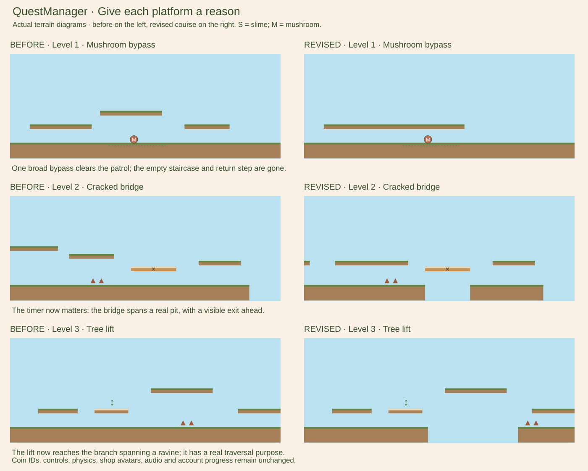

# Course review: Levels 1–3

This pass addresses a design problem: a reachable ledge is not automatically a useful
ledge. Too many sequences climbed above safe ground, repeated the same staircase,
or ended at a recovery block that the player did not need. The changes below remove
24 elevated platforms and make remaining routes serve coins, avoidance or crossings.
This is a reviewable gameplay revision, not a claim that the courses are finalized.



These are diagrams of actual geometry, not browser screenshots. They show three
representative changes; the table below describes the wider pass.

| Level | Elevated platforms before → after | Main changes |
| --- | --- | --- |
| 1 · The First Adventure | 34 → 25 | A single easy-coin ledge replaces the empty opening staircase. Mushroom bypasses end beyond the patrol; unnecessary descent/recovery blocks are removed. Clover Hollow now bypasses a thorn patch. The requested final-climb pit and flag steps remain. |
| 2 · The Winding Grove | 57 → 48 | Lower, connected avoidance routes replace repeated high climbs. Fern Walk's cracked bridge now spans a real pit. Patrol bypasses connect to the ferry, takeoffs or the flag climb. Root Gallery's low shelf now bypasses thorns instead of being a cosmetic detour. |
| 3 · Deep Forest | 33 → 27 | One opening coin branch replaces practice padding. Fern Passage bypasses thorns without an unused overhead platform. The tree lift now reaches a branch across a real ravine. The Heart cracked bridge spans a real gap. The empty clearing ledge is gone. |

World lengths, section boundaries and finish locations are unchanged. Two ground
segments were split to open actual pits, so total platform counts are now 36, 61 and
38. Coin IDs remain `level-N-coin-1/2/3`; moving coins does not erase saved credit.
Controls, player physics, enemies/stomping, animation, audio, settings, map, account
storage and completion-based saving retain their shared implementations.

## What was removed or repositioned

### Level 1

- Opening: remove `practice-2/3`. The single x220 ledge is 180px wide; Coin 1 is now
  directly above it at (330,335). It teaches one clear jump-and-reward detour.
- First mushroom: replace the x2250/2500/2800 staircase with one x2250–2750 bypass.
  Its end clears the patrol rather than dropping the player back onto it.
- Rolling Ridge: remove the empty thorn-exit and mushroom-exit blocks. The mushroom
  bridge is now x7130–7430, y335, with a clear drop beyond the patrol.
- Sunlit Fields: the east bridge is x10280–10700, y335; remove its redundant exit.
- Final coin approach: extend the mushroom bridge to x12350 and lower it to y335;
  remove the empty rest block and last isolated stomp block. Keep the coin climb.
- Clover Hollow's shelf crosses a small thorn patch at x4550. Players can instead
  jump the patch on the main route without needing to discover the optional shelf.

### Level 2

- Opening: remove `practice-2`; Coin 1 is now (280,335), above the one x200 ledge.
- Fern Walk: remove `fern-3`, lower/widen `fern-2` to x3340–3620, y335, and connect
  it to the x3710–3970 thorn bridge. Remove ground x4030–4190 under the cracked
  board. Jump to the existing x4270 exit before its one-second warning ends.
- Mushroom Bend: remove `bend-3`. A low x6640–7080 bypass leads into the ferry dock.
  Combine the shallow upper lane into x8350–8900 and remove `shallow-3`; widen the
  final takeoff to x9040–9300 so the lane leads to the next crossing.
- Root Hollow: remove `hollow-3` and `root-3`. The x9930–10540 bridge clears both
  its mushroom patrol and thorns. The slime lane runs x11400–12000; the next thorn
  crossing is x12080–12250. The raised gap takeoffs remain.
- Sparrow Ledges: remove `sunbreak-3`; the lower x13320–13900 bypass connects to the
  thorn/gap takeoff. Root Gallery's shelf bypasses thorns at x15580.
- Lookout: remove `lookout-3` and `lookout-thorns`. One x16350–17130 upper lane
  clears the patrol and thorns and leads toward the existing final flag climb.

### Level 3

- Opening: remove `intro-branch-2`, `intro-exit` and `stomp-branch`. Coin 1 is now
  (310,335), above the remaining x220 branch.
- Fern Passage: remove the unused roof platform and its decorative support. The
  lower shelf now bypasses thorns at x4590; the normal ground jump remains viable.
- Tree lift: remove ground x7740–8060. The existing lift and x7800 branch now solve
  a required crossing. Move the thorn patch to the far bank at x8080, before the
  visible raised exit. The lower forest is not an invisible safe route anymore.
- Heart: combine the mushroom bypass into x8900–9380, y335; remove `heart-step-3`.
  Lower the x9440 takeoff to y365. The pit is x9700–10000; the cracked bridge moves
  to x9750–9900. The x10000 landing is safe. Keep the optional final coin sequence.
- Clearing: remove the isolated x12080 recovery ledge; retain the useful takeoff
  for the last gap and the safe ground flag. Update branch scenery to match terrain.

## Test from VS Code

```sh
git switch game-prototype
git pull --ff-only origin game-prototype
npm test
npm run validate:levels
py -m http.server 8000
```

Hard-refresh http://127.0.0.1:8000/game/ on your usual browser/origin. Existing
unlocks and coin credit remain. Already-earned coins appear faded at the new spots.

Play Level 1 first, then 2 and 3. For each section, judge whether you can see the next
landing, understand why a ledge is useful, choose a route deliberately and recover
after the encounter. Test the single opening coin jump, then the representative
sections in the diagram. Especially try:

1. Level 1's first mushroom bypass: one climb, cross above the patrol, drop safely.
2. Level 2's Fern Walk: follow the low lane, leave the cracking bridge and reach the
   visible exit. Waiting on it should now cause a fall and normal restart.
3. Level 3's tree lift and Heart bridge: ride/jump across their ravines. Pause while
   riding or while the board warns, resume, and verify timing/focus remain normal.
4. The lower ground jumps and optional secret shelves in all three levels. Both
   choices should work; coins 2 and 3 should still reward distinct optional routes.
5. Collect all coins, finish, replay and check saved credit; also finish without
   collecting coins. Die after collecting one and verify new attempt coins reset.

## Automated verification and limits

Recorded real-input runs are renewed for all three courses: all-three-coin and
zero-coin main routes at 30/60/120 FPS. They use the actual movement, patrol, hazard,
platform, camera and collection code, with no teleports or removed enemies.
Existing local secret-entry/reward/reconnection witnesses still pass. Boarding,
carrying, reversals, reset, map, progress, audio and pause checks remain in the suite.

New tests check the one-ledge coin detours, clear bypass exits, real empty space
under the new timing challenges, last-moment escape and falling after collapse.
Both Deep Forest main/coin routes are checked to actually use its lift and cracked
ravine bridge. The safe-floor collapse/audio unit fixtures now explicitly construct
safe terrain: they still test harmless collapse where ground exists, while separate
live-course tests verify the new pits cause falls.

The physics jump graph checks reachability; it does not score fun. Optimized full
runs take roughly 49–64 seconds, not a human playtime estimate. Before/after diagrams
were visually inspected. Browser playtesting and your judgment of flow, readability
and enjoyment remain necessary. No later levels, master merge or Supabase changes
are included.
