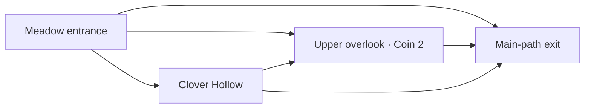

# Secret areas and alternate routes

Implemented on `game-prototype` on top of the approved layout update `f2152b4`.
The exploration feature still awaits Victoria's personal gameplay approval.

## Design

The levels retain their ground islands, finish flags, enemy patrols, hazards,
themes and six existing coin identities/positions. Exploration adds two sheltered
lower shelves, a small moving canopy connector, and decorative foliage around
selected existing upper routes. No extra special coins or currencies were added.

The lower passages sit beneath existing elevated ledges, above safe ground.
They are not fake holes through dirt, invisible collision walls, or underground
spaces outside the camera. A missed jump can return to the main path. The upper
routes reward exploration with the existing medium/hard coins; the small meadow
nook provides a sheltered lower connector and a discovery notice.

| Level / route | Where to look | How to enter and leave | Reward / purpose |
| --- | --- | --- | --- |
| 1 · Meadow Overlook | Meadow steps at x=3900, 4140 and 4380 | Climb to the partly leafy shelf at y=260, then use the exit ledge at x=4740 or drop to the meadow | Existing Coin 2 at x=4500, y=230 |
| 1 · Clover Hollow | Under that overlook, x=4430–4590 | Look for cream flowers and a hedge opening. Jump onto the lower shelf at y=365; continue to the x=4740 connector or drop to safe ground | Optional sheltered lower route; can also jump upward through the existing one-way perch |
| 2 · Leafy Canopy | Above the lower slime, x=4700–5950 | Climb x=4700/4910 to the long x=5120 canopy. Time the mushroom, collect Coin 2, then ride or jump over the moving bough at x=5620–5690. Drop beyond x=5950 | Existing Coin 2 at x=5540, y=230; an elevated alternative to the lower lane |
| 2 · The Winding Crossing | Mushroom Bend dock, x=7200–7510 | Wait for the ferry at x=7560–7770, jump aboard and jump to the far bank. It reconnects before the next slime | Upper crossing versus the lower main-route jump; no coin requirement |
| 2 · Root Gallery | Beneath the last gold steps, x=15540–15680 | Look for flowers and the curved root. Jump onto the sheltered y=365 shelf, then jump straight up through the y=260 grassy ledge. Continue to the collapsing takeoff at x=15750 and leap for gold; land in the x=15930 clearing | Alternate approach to existing Coin 3 at x=15910, y=190 |



Foliage starts translucent and fades further before the player reaches it. Shelf
edges, flower gaps, and coin silhouettes provide clues; there are no giant arrows,
locked entrances or guessing-only invisible platforms. Hazards, creatures, coins
and the player draw above this foliage. A brief discovery notice sits below the
walkable ground; the existing status text also announces the find.

Discovery requires landing on a named route surface inside its bounds. Running
along the ground below, or jumping through the area without landing, does not
automatically discover it. Discoveries and their notices are attempt state only:
death/R/replay/account changes clear them through the existing restart path.
They never write to the coin/progress store. Coin credit still saves only at the
finish, including faded previously earned coins on replay.

## Reusable pieces

- `levels/Exploration.js`: attempt discovery, reconnection tracking, foliage reveal and notice timing.
- `rendering/ExplorationRenderer.js`: cosmetic leaves, hedge openings, roots and discovery notice.
- `explorationAreas` in each level: bounds, entrance/exit regions, intended platform IDs, discovery surfaces, clue, purpose and optional existing coin ID.
- `levels/design/validateExploration.js`: references, safe entrance/exit support and visible world bounds.
- `levels/design/simulateExploration.js`: explicit local entrance-to-reconnection witnesses using the existing gameplay tick.

The normal `LevelManager` constructs/resets discovery state and the shared tick
updates it after lethal contacts are checked. The existing rendering order keeps
threats legible. No new physics, collision engine, database integration or vertical
camera was introduced. The current viewport fits both the upper and lower routes.

## Run in VS Code

Pull the latest `game-prototype` branch, then run from the repository root:

```sh
npm test
npm run validate:levels
py -m http.server 8000
```

Use `python -m http.server 8000` if your Python command is `python`. From the repo
root, open http://127.0.0.1:8000/game/ using the same browser/origin as your saved
progress. Complete Level 1 first if this account has not unlocked Level 2.

1. Complete each level using the lower main route and skip its upper branches.
   No discovery or coin is required to finish.
2. Replay and use the table above to find each route. Watch foliage fade as you
   approach; ensure openings and the next landing are understandable without this guide.
3. Test both entrances and easy drop-back exits. In Root Gallery, try the straight
   upward jump and the original upper staircase as separate approaches to Coin 3.
4. Ride the new canopy bough without movement, wait through reversals, and jump
   off toward the exit shelf. Compare the ferry path with its lower alternative.
5. Die, press R, finish/replay and change accounts. Check discovery reset, enemies,
   platform resets, saved/faded coins, completion popup, map and equipped avatar.

## Verification and limits

Automated checks separately cover full spawn-to-flag runs with all three coins,
main-route runs that reject secret landings and coin pickups, and 15 local
entrance/discovery/reward/reconnection witnesses (five areas × three frame rates).
Coin-linked witnesses require their actual existing coin; collection is never
disabled. Local witnesses explicitly start on declared safe entrance terrain;
they are not described as whole-level playthroughs.

The canopy bough is tested for boarding, a complete riding cycle and a safe exit
from three starting phases at 30/60/120 FPS. Tests cover reveal timing, one-time
notices, reset, invalid exits/references, unchanged definitions and cosmetic drawing.
The existing regression suite continues to cover saving/account isolation, enemies,
stomps, collapse behavior and navigation.

These are automated simulations and runtime canvas renders, not a browser playtest.
Visual discoverability, timing comfort, challenge and enjoyment still require your
personal testing and approval. No level or exploration feature is finalized here.
