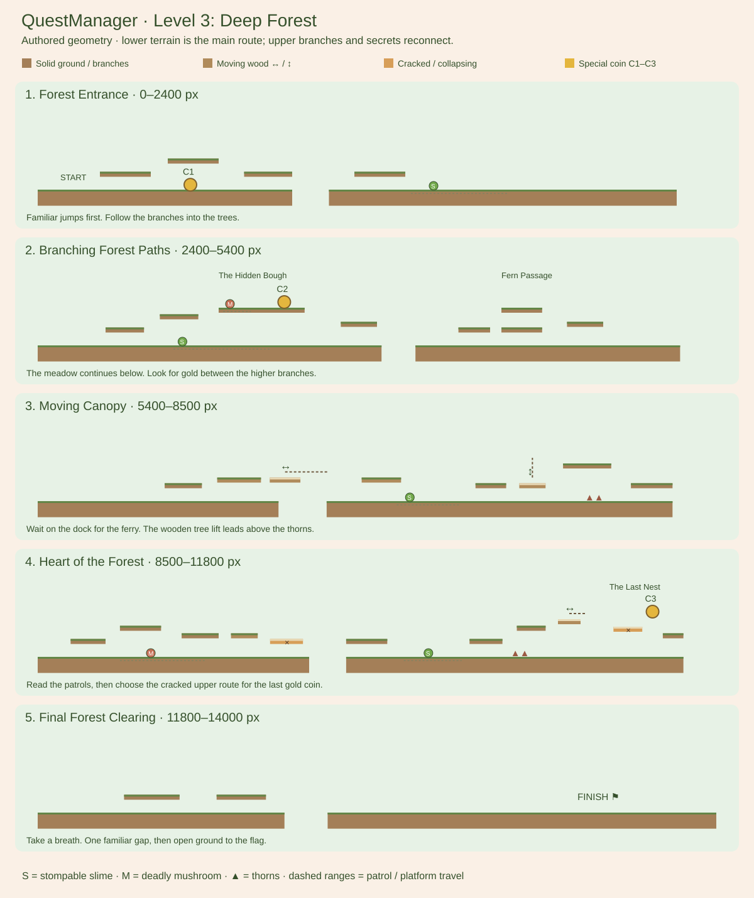

# Level 3: Deep Forest

Implemented on `game-prototype`. Gameplay, difficulty, visuals and listening approval
are pending your own browser playthrough. See COURSE_REVIEW.md for the course-design pass and PLATFORM_DESIGN_RULES.md for the latest special-platform placements.

## Open in VS Code

```sh
git switch game-prototype
git pull --ff-only origin game-prototype
npm test
npm run validate:levels
py -m http.server 8000
```

Open http://127.0.0.1:8000/game/ on the same browser/origin you used for saved coins,
then hard-refresh. Complete Level 2 on that account to unlock Level 3; perfect coin
collection is not required. Click node 3 → inspect its details and three coin icons
→ Play. Existing accounts that completed Level 2 already have access. No progress
reset or database migration is needed. Direct `#level-3` links still respect locks.



Horizontal scale differs between sections in this diagram; gameplay uses the world
coordinates below. S marks slimes, M marks mushrooms. Only real terrain is drawn.

## Five sections and test targets

| Section | World x | Intended play |
| --- | --- | --- |
| Among the Roots | 0–2400 | Cross the root gap at 500–620, climb the y390 root bank, choose the supported bough at x1000–1320 for Coin 1 at x1180/y270, then return to the lower slime encounter. |
| Branching Forest Paths | 2400–5400 | Follow lower terrain or climb 2700 → 2940 → 3200 to the Hidden Bough. Avoid its short mushroom patrol and collect Coin 2 at 3490. Drop back near 3820. Find the low Fern Passage at 4450 and reconnect near 4970. |
| Moving Canopy | 5400–8500 | Wait on the wooden dock at 6220. Board the horizontal ferry at 6460–6660 and exit at 6880. Approach the tree lift from 7400, ride from y365 to y260, then jump to the high branch at 7800 across the root ravine. Stay on the upper route past the far-bank thorns and reconnect at 8110. |
| Heart of the Forest | 8500–11800 | Time the mushroom bypass, then cross the cracked bridge at 9750. The optional nest climb starts at 10600; cross the swaying bough at 11030 and cracked ledge at 11300 for Coin 3 at 11490. Both cracked bridges warn for 1.1 seconds and are over real pits. Reconnect to the clearing at 11800. |
| Final Forest Clearing | 11800–14000 | Open scenery, recovery room and one familiar final gap. The flag is on safe solid ground, with no last-second enemy or thorn trap. |

The main route can finish with zero coins and without landing in a secret. The lift
and Heart of the Forest cracked bridge are now meaningful main-route crossings. The
medium/hard coin routes reward exploration; all three coins fit one successful run.
The 220px stream gap has a raised dock and ferry. Do not treat it as a flat-ground
jump. The 200px gap after the lift has a raised takeoff ledge.

## Manual checks

- Walk the entrance, use Space/W/Up, and test both lower and upper paths. Slimes
  can be stomped; mushrooms remain deadly. Check landings and patrol readability.
- Board each moving platform, ride through a reversal without holding movement,
  jump away and return. Try waiting for a different phase before boarding.
- Stand on a cracked bridge: warning → collapse → fall to lower terrain. Collapse
  alone does not kill. Jump away before it breaks, then R/death/replay to restore it.
- Find both secrets and the optional nest. Foliage should fade near the opening;
  coins/enemies stay visible. Confirm each route reconnects instead of trapping you.
- Die after a new coin: it must return and remain unsaved. Reach the flag with
  coins: the Level 3 popup must show saved icons; replay shows earned coins faded.
- Finish with no new coins. Replay and return to the map. Level 4 unlocks in
  progress data but stays unavailable; Next Level says Coming soon. No auto-next.
- Pause on a moving or cracked platform, wait, resume, change volume and toggle
  Reduce Motion. Listen to Deep Forest's distinct original theme. Muted play must
  retain visual cues. Check account changes do not share achievements/settings.
- Revisit Levels 1 and 2 and check their familiar routes, coins and finish behavior.

## Architecture and changes

- `levels/Level3.js`: five authored sections, 39 platforms, six predictable patrols,
  three thorn patches, three stable coin IDs, three optional discovery areas and flag.
- `levels/Level3Scenery.js`: hand-placed trees, bushes and flowers, with large branch
  anchors under selected platforms. Trees build in density, then open at the finish.
- `rendering/GrasslandRenderer.js`: opt-in Deep Forest backdrop, richer greens,
  scalable trees/branch supports and wooden bridge appearance. Sky remains the same
  light blue. Decorations draw behind gameplay and never create hitboxes.
- `levels/levels.js`, `index.html`: register Level 3 and name its existing map node.
  Existing shared progression/UI handle unlocking, details, completion and replay.
- `audio/SynthAssets.js`: a sparse original D-minor Deep Forest score (78 BPM), using
  the existing soft retro instruments, mute/volume controls and pause behavior.
- Tests/fixtures: new real-input full routes, secret entrances/exits, ferry/lift
  boarding at multiple phases, collapse/reset, account progress, audio and actual
  game-entry completion/pause integration. No new physics or persistence system.

## Validation versus playtesting

Full spawn-to-flag simulations run with all three coins and with zero coins at
30/60/120 FPS. Inputs include real jumps and waits; no teleports, removed enemies or
hidden floors. Optimized runs take about 49 seconds, not an estimate of a human's
first attempt. Local graph checks cover all platforms. Nine separate local secret
witnesses start at their declared entrances and verify entry, rewards and safe exit.
Those local witnesses are not whole-level playthroughs.

Dedicated ferry and lift tests board from three starting phases at each frame rate,
ride through reversals and jump off. Collapse tests check warning, release and reset.
The actual entry-point test uses mocked DOM/auth/audio boundaries and teleport setup
only for completion UI checks; route simulations separately establish playability.

Canvas-rendered scenery was visually inspected outside the browser. Browser gameplay
and listening were not manually tested here. Reaction time, readability, repetition,
audio comfort and overall fun still need your approval before Crystal Cave begins.
