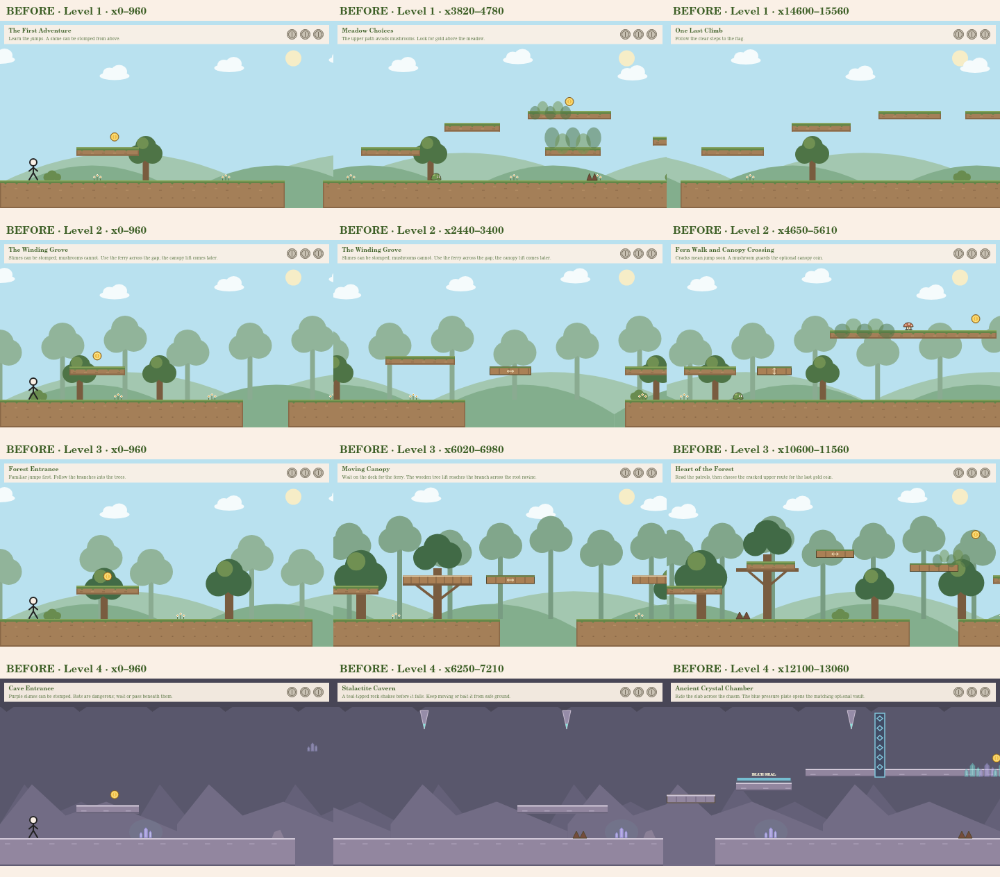
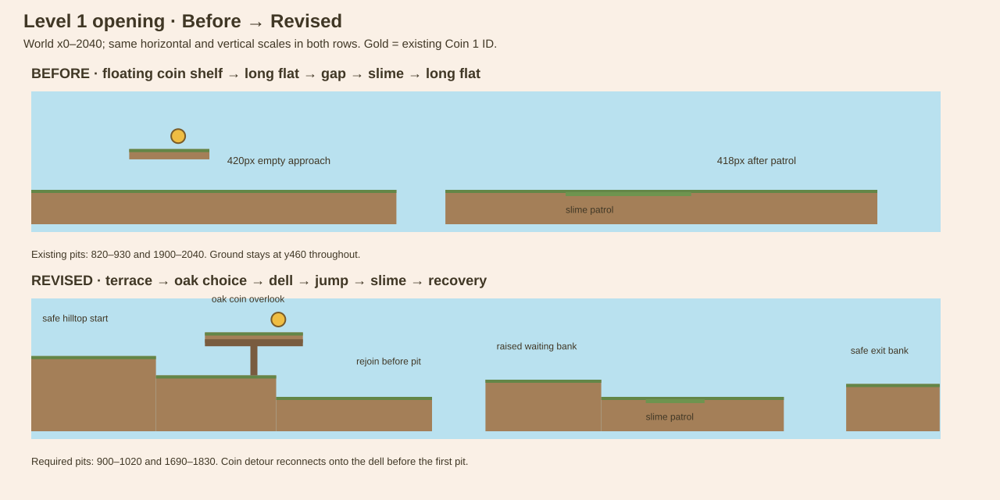
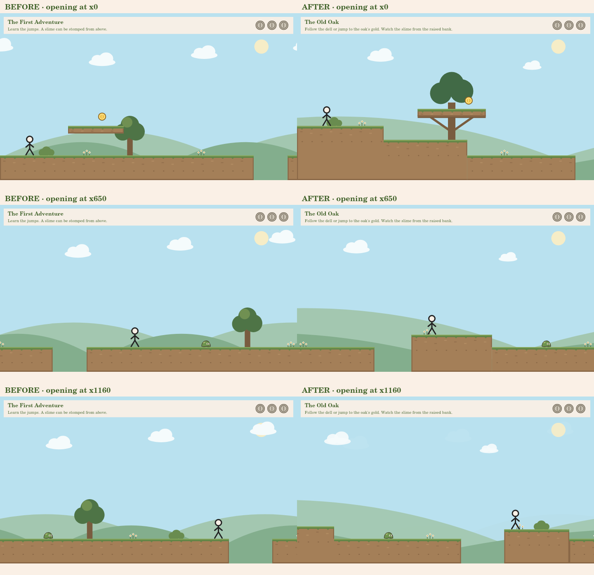

# Gameplay quality review and Level 1 opening demonstration

> This records the approved Level 1 demonstration. The subsequent Levels 2–4 pass is documented in [Other-level quality review](OTHER_LEVEL_QUALITY_REVIEW.md); its later changes supersede the historical descriptions of those levels below.

Review baseline: `game-prototype`, remote commit `438a10a8a48806401e20454c019eb64a5a6c44a9`.

This pass changes only Level 1's opening, x0–2040, plus opt-in rendering support for that opening and corresponding validation/tests. Publishing this scoped revision was authorized after the before/after review. Levels 2–4 are evaluated here but not redesigned. This is a demonstration awaiting human playtesting, not a claim that the game is polished or finished.

## What was actually inspected

- Read all four level configurations, scenery, shared physics/landing and enemy collision, camera, avatar renderer, terrain/background drawing, exploration, progress, pause/audio/developer integration and current tests.
- Tried to launch headless Chromium through Playwright. It exited before opening a page: `process_singleton_posix.cc:297 ... socket() failed: Operation not permitted (1)`.
- Rendered 12 representative views with the actual canvas renderers: Level 1 at camera x0/3820/14600; Level 2 at x0/2440/4650; Level 3 at x0/6020/10600; Level 4 at x0/6250/12100. Inspected those renders and the revised opening comparisons.
- These images are **native canvas layout captures, not browser screenshots or playthroughs**. They use the existing fallback stick character because no user's authenticated shop loadout is available offline. Avatar code/design was not changed.

**Cannot verify here:** real browser input/latency, human jump timing, subjective movement rhythm, music/sound balance, browser text scaling, equipment loading under a real account, or whether the secrets feel rewarding to discover. Automated routes cannot establish those qualities. Static captures also do not demonstrate animation transitions or difficulty across an entire run.

## Concrete findings

These are source/render observations and design judgments, not claims of human playtesting.

| Location in existing code | Specific issue | Player-experience implication |
| --- | --- | --- |
| Level 1, introduction: ground x0–820 and 930–1900 at y460; optional ledge x220–400 at y365; Coin 1 x330/y335 | The skyline is two flat ground strips plus one suspended rectangle. Ledge end x400 to pit x820 leaves 420px with no new decision; patrol ends x1482 and the next pit starts x1900, another 418px. | The coin, gap and slime read as independent props rather than a connected place. These intervals consume about 1.5s each at full running speed. |
| Level 2, introduction: easy-coin ledge x200–360/y365 and Coin 1 x280/y335 | Repeats the opening coin shelf/flat-bank idea before the useful ferry sequence later in the section. | The forest palette adds atmosphere but the first interaction is highly familiar. |
| Level 3, Forest Entrance: ground x0–900 and 1030–2260; ledge x220–400/y365; Coin 1 x310/y335 | Again follows shelf → long flat → gap → slime. | A third region begins with the same spatial sentence even though later tree-supported routes are more distinctive. |
| Level 4, Cave Entrance: ground x0–850 and 970–2660; ledge x220–400/y365; Coin 1 x330/y335 | Crystals/rock color create the clearest theme change, but the opening geometry is nearly the same template. | Strong palette identity does not by itself create a different opening experience. |
| Static elevated surfaces across Levels 1–4 | Before this pass, y365 is used by 12/25, 22/39, 12/22 and 7/12 static raised surfaces, respectively. All first coins sit at y335. | Reusing a jump tier helps learning; repeating the same context around it makes routes/coin locations predictable. Random height changes would not solve the underlying problem. |
| Level 1, Rolling Ridge: ground x5200–6500; thorn patch x5980–6020 | Even after the thorn encounter there is roughly 480px before the ground edge. Later encounters similarly sit in long horizontal ground strips. | Recovery space is useful, but repeated long recovery strips can flatten the rhythm. This later section is left untouched for now. |
| `GrasslandRenderer.drawBackground/drawForest` | Clouds repeat every 330px; hills use 710/530px periods; ordinary forest silhouettes repeat every 180px and Deep Forest every 145px. Levels 1–3 share the sky, sun and hill system. | The repeated tree/crown spacing reads as a pattern. Deeper forest density helps but landmarks are scarce. |
| Level 1, Meadow Choices: upper perch x4380–4620/y260; Clover Hollow x4430–4590/y365 | The secret veil is a small group of translucent leaf/hedge ovals on exposed rectangular shelves. The reveal begins near a 140px expanded detection area. | It is mechanically an optional route, but visually resembles another shelf with an overlay rather than a sheltered hollow. |
| Level 4, Ancient Crystal Chamber: vault x12500–13200/y260; foreground crystal veil x12960–13085 | The switch/gate has a real optional purpose, but the "hidden passage" is still an open elevated strip rather than a tunnel-shaped space. | The puzzle is distinct; the surrounding room silhouette could communicate the place more strongly in a later pass. No Level 4 geometry changed here. |

Existing promising examples are the ferry across Level 2's x2820–3280 void and Level 3's branch-supported crossings: those have an obvious destination and a visual reason for their structure. The revised opening uses the same principle of visual support without introducing a new mechanic.

## Proposal shown before changing gameplay

Replace the opening's flat strips with a short descending landform, an oak-supported optional overlook, a first gap leading to an observation bank, a separate slime encounter and an exit jump with recovery space.

The initial proposal placed the overlook at y320; visual review raised it another 10px to y310, leaving **12px of standing headroom** above the lower terrace. The final diagram reflects the implemented position.

| Beat | Revised coordinates | Gameplay purpose |
| --- | --- | --- |
| Safe hilltop | Start bank x0–280/y365; spawn x80, feet y365 | See the oak/optional gold before facing damage. |
| Gentle descent | x280–550/y410, then x550–900/y460 | Natural downhill movement with no new slope/side-wall physics. Adjoining banks descend; they do not create upward walls the existing one-way controller cannot resolve. |
| Optional oak overlook | x390–610/y310; Coin 1 x555/y280; tree support x500, branch underside y334, roots at y410 | A supported landmark instead of an unexplained floating shelf. Jump from the hilltop or lower terrace; collect gold, then drop into the dell before the first pit. Same stable Coin 1 ID. |
| First required jump | Pit x900–1020; broad landing x1020–1280/y420 | A readable 120px crossing with a 40px rise, enough room to land and observe the next encounter. |
| First slime | Ground x1280–1690/y460; patrol x1380–1480, speed 60 | Choose a stomp or an avoidance jump after a separate safe landing. The raised bank is above the slime's hitbox; the patrol cannot touch a player still waiting there. At least 178px separates its maximum right edge from the next pit. |
| Exit and recovery | Pit x1690–1830; recovery bank x1830–2040/y430 | Apply the familiar jump, recover on a clear bank, then descend 30px into the unchanged Meadow Choices section. |

There is still one optional coin platform, one slime and two pits. The extra terrain rectangles sculpt the ground silhouette; they are not extra floating obstacles. The opening length remains 2040px and Level 1 remains 16000px long. Coins 2/3, all later sections, finish flag, other levels and saved IDs remain unchanged.

## Visual changes and comparison

- The oak's branch reaches the overlook's underside and its roots meet the correct terrace. It is the focal point, not one of several competing foreground trees.
- Decoration bases follow the actual terrace elevations. Pit takeoffs, landings and enemy silhouettes stay clear; later scenery positions remain identical.
- Adjacent earth banks share soil beneath their neighbor's top. Borders only outline exposed risers, avoiding misleading vertical seams that resemble pits.
- An authored, sparse cloud arrangement and broad uneven hills frame the opening, then fade into the existing background by camera x2040. The cream/green/brown/blue palette stays the same.
- The effect is opt-in to this Level 1 opening. Levels 2–4 produce identical existing background/terrain draw commands at the reviewed camera positions.

## Verification and remaining approval

Automated verification uses the unchanged speed 280, jump strength 650, gravity 1800 and player 32×64. Measured maximum rise is 106.7/112.0/114.7px at 30/60/120 FPS; same-height full-speed travel is 196.0/200.7/200.7px. Gap design uses the discrete simulation, including the target height, not only those envelope numbers.

The revised full input witnesses start at the normal spawn and reach the flag with all three coins at each frame rate; those paths actually land on the oak overlook. Separate zero-coin paths skip the overlook and both later secrets. No noclip, teleport, developer assistance, enemy removal or altered physics is used in those full-route proofs. All other level route fixtures stay unchanged.

Additional encounter tests check both required gaps from three takeoff offsets at 30/60/120 FPS, a safe walking drop from the overlook, worst-position slime stomp recovery, real fall deaths in both holes, terrace headroom, scope preservation and rendering preservation. Local encounter setups are not full playthroughs. Optimized full-level traces still finish in about 56.5 seconds; that is reachability evidence, not a human pacing target.

Executed after the final layout change:

- `npm test`: **158 tests passed**, including all prior tests and ten new opening-quality checks.
- `npm run validate:levels`: passed the Levels 1–4 layout, full all-coin/zero-coin routes and existing exploration witnesses at 30/60/120 FPS.
- Native canvas inspection: twelve existing section views plus three matched before/revised opening views.
- Browser playtesting: unavailable due to the launch restriction described above.

Test results establish correctness and feasible timings; they do not establish enjoyment or approval.

## How to manually review after the update is authorized and pulled

1. Keep a few minutes focused on the opening rather than clearing the whole level immediately. Begin with a normal run and no developer assistance.
2. Stay low on the first pass. Check whether the descent, first pit's far bank and slime waiting area read clearly without studying coordinates. Try more than one takeoff timing; see whether the recovery after a stomp feels comfortable.
3. Replay for the oak coin. Try jumping from the hilltop, landing on the overlook, then walking off into the dell. There should be time to prepare for the first pit rather than an immediate forced jump. Your saved Coin 1 ID remains credited; use the existing confirmed developer coin-reset option only if you want it gold again.
4. Check your equipped character under the branch and against the sky/greenery. These offline captures do not verify your real account's equipment loading.
5. Check the section transition at x2040 and play into Meadow Choices. Its platforms, enemies, two exploration routes and remaining coins should be familiar.
6. Use dev tools only for a second inspection: verify the visible earth tops match hitboxes and that the holes have no floor. Assisted completions must still show TEST RUN and save nothing.
7. Check real keyboard responsiveness, camera comfort, audio and narrow-window readability. Give feedback on these rather than treating the automated passes as a recommendation to finalize.

## Changed code responsibilities

- `levels/Level1.js`: only opening data, spawn and optional opening-vista parameters.
- `levels/Level1Scenery.js`: only decorations before x2040; tree/flower/bush bases match the new landform.
- `rendering/OpeningLandscape.js`: cosmetic authored vista and fade.
- `rendering/GrasslandRenderer.js`, `SceneryGeometry.js`: opt-in earth joins and scenery bases; default rendering remains unchanged for other levels.
- `game.js`: forwards the optional vista configuration to the existing background renderer. No control, save, pause, audio or developer logic is changed.
- `levels/design/validateLevel.js`: includes authored terrain banks when checking gaps and validates standing headroom under the overlook.
- `tests/opening-quality.test.mjs`, `fixtures/opening-scope-baseline.json`: real encounter tests and a baseline protecting the scope/default rendering.
- `fixtures/level1-routes.json`, `level1-main-routes.json`: updated real-input timings for the changed opening. Existing full-route requirements remain enforced.
- This review and `docs/*quality*`: visual evidence and the before/after plan.
