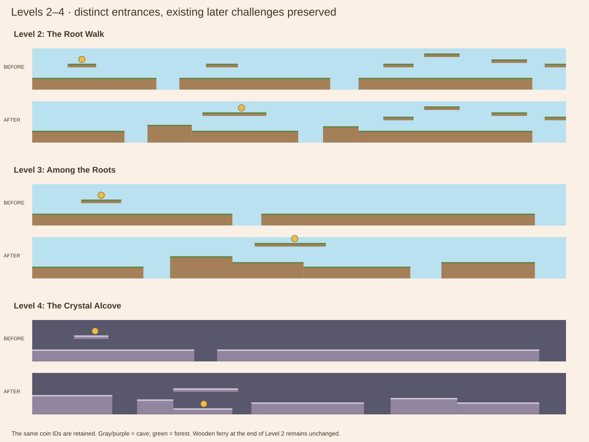
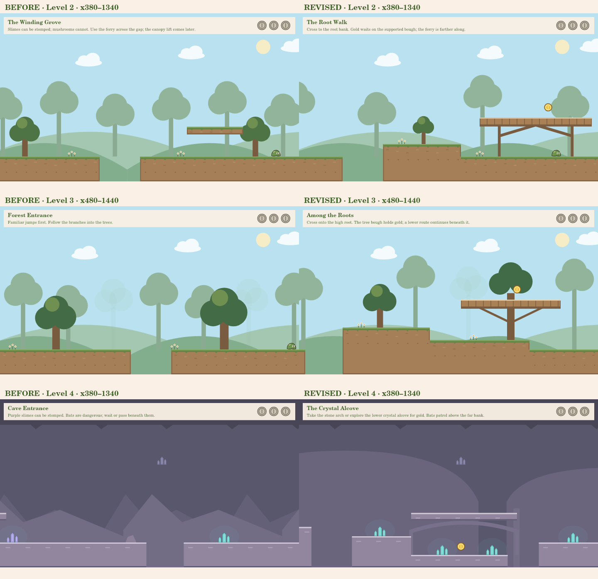
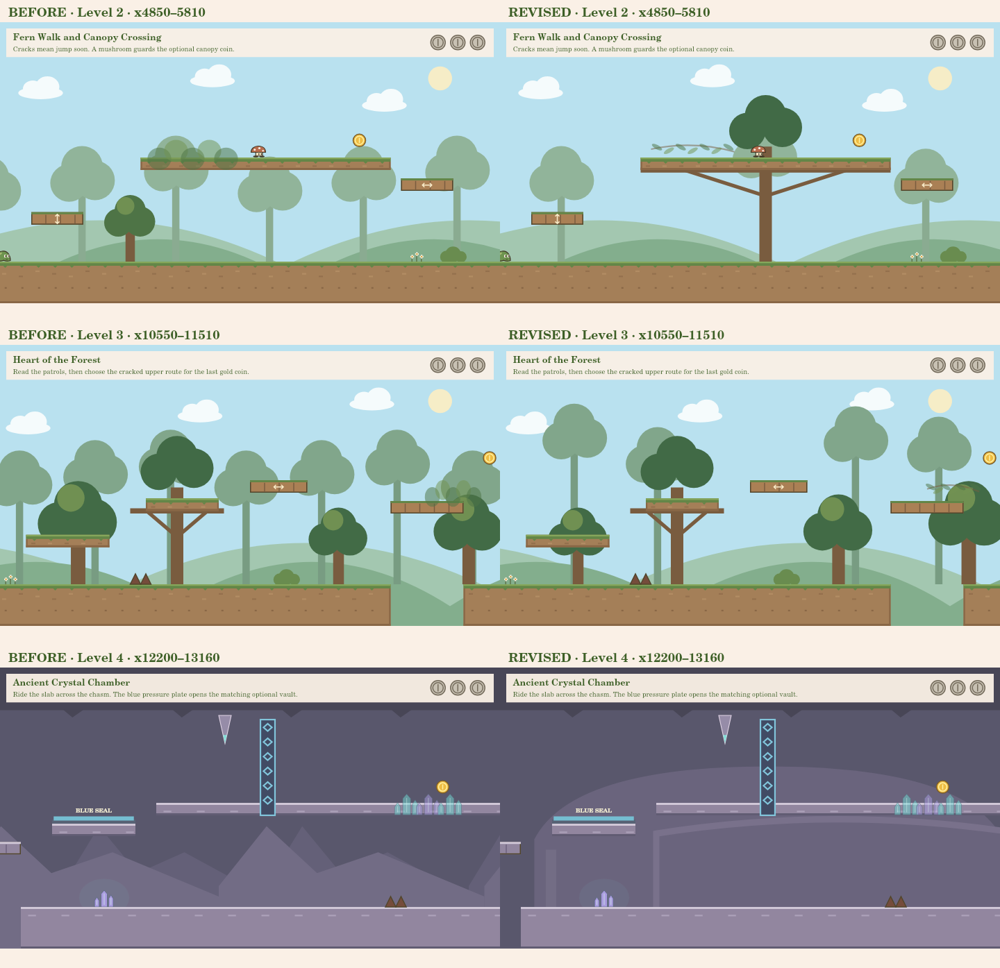

# Levels 2–4: entrance and environment quality pass

Baseline: `game-prototype` at `1bd431eb32e8e75011e7250e401cfbfb5f93390f`.

This applies the approved Level 1 approach to the other existing levels: replace the repeated entrance arrangements, make route choices belong to visible terrain, and anchor selected later routes. Level 1 is unchanged. This is not an assertion that every later encounter has been fully redesigned or approved; the existing later challenge geometry is deliberately preserved while its presentation improves. No additional levels or gameplay mechanics are added.

## Scope and before/after plan

| Level | Original weakness | Revised entrance and rhythm |
| --- | --- | --- |
| 2 · The Winding Grove | Easy coin on the x200/y365 floating shelf, flat gap, another low stomp shelf and a broad patrol. | Root bank across a first gap, supported wooden bough over the first slime, a lower avoidance/stomp route, recovery bank, then the existing mushroom/ferry approach. |
| 3 · Deep Forest | Repeated x220/y365 opening shelf and long flat floor, despite the later theme's strong branch routes. | Higher root terrace, visible optional bough across from it, a descending lower corridor, one short patrol and a clear return bank. |
| 4 · Crystal Cave | Another x220/y365 coin shelf and flat ground, with mountain-like cave background triangles. | A lower crystal alcove beneath an upper stone crossing. Routes rejoin before a separate slime encounter and an overhead bat corridor. Background room arches and recessed masonry reinforce the cave setting. |

These are native canvas captures using the real renderers, not browser screenshots. No real user's shop/account data was loaded. The comparison views focus on layout/scenery; character appearance and animation code were not changed.

## Level 2 — The Root Walk

- x0–520/y460: safe starting floor.
- x520–650: first 130px gap; x650–900/y420 is the broad root bank.
- x900–1500/y460: lower dell and a short slime patrol, x1120–1230. The patrol leaves room before the next pit.
- x960–1320/y335: supported wooden bough; Coin 1 moves to x1180/y305. It is a useful upper bypass of the slime, rather than a shelf placed before an unrelated challenge.
- x1500–1640: second gap; x1640–1840/y430 is the return bank, descending into the existing approach.
- The mushroom bypass, ferry dock x2590–2790, moving ferry x2890 onward, and real x2820–3280 river are unchanged.

Selected later landmarks gain explicit supports: the fern bypass at x3520–3970, canopy coin shelf x5120–5600, canopy exit x5900–6150, Root Gallery/gold perch near x15610 and final lookout bridge x16350–17130. Supports remain scenery; none adds a duplicate crossing or hidden collider.

## Level 3 — Among the Roots

- x0–500/y460: safe floor before the root gap.
- x500–620: 120px gap; x620–900/y390 is a higher root bank. It has a different elevation and approach from Level 2.
- x900–1220/y430 and x1220–1700/y460 form a downhill lower route.
- x1000–1320/y300: a broad branch supported by a large tree rooted on the lower terrace. Coin 1 moves to x1180/y270.
- The slime patrol is shortened to x1380–1460, leaving recovery before the x1700–1840 pit.
- x1840–2260/y430 is the return bank; the existing gap into Branching Forest Paths remains.

The later Hidden Bough, ferry/lift, timed ravine bridge and final moving/collapsing coin route retain their geometry and timing. Existing branch anchors are kept; small supports at the branch exit and fern passage connect those routes visually. Organic leaf/root sprigs replace the floating oval veils in the forest secret areas. Their reveal/discovery rules are unchanged.

## Level 4 — The Crystal Alcove

- Spawn remains x80, now with feet on the y410 starting shelf, x0–420.
- x420–550: first gap; x550–740/y440 is the approach bank.
- Upper route: stone crossing x740–1080/y365. It skips Coin 1 and drops safely to the far passage.
- Lower route: alcove floor x740–1050/y500, Coin 1 x900/y470. The floor is visible and solid, not an offscreen pickup. A 100px gap to x1150/y460 provides an achievable exit jump.
- Main passage x1150–1740/y460: short slime patrol x1410–1500, separated from the return and next pit.
- x1740–1880: next crossing; x1880–2230/y430 is the bat bank. The bat patrol's feet are at y335, leaving 31px above the standing player's head. Walking underneath is safe; jumping still requires observation.
- x2230–2660/y460 reconnects with the unchanged passages.

The cave background uses broad, uneven chamber arches rather than repeating pointed hills. Recessed arch outlines frame the entrance crossing, crystal gallery, thorn bypass and vault. These lower-contrast shapes are background masonry, not invisible walls. Light rock edges, teal dangerous rock tips, coin silhouettes and the blue gate remain distinct.

All later falling rocks, the 440px ferry chasm, cracked slab, blue plate/gate and two secret routes retain their exact configurations. The hardest coin and optional puzzle remain optional.

## Shared visual work and restrictions

Forest backgrounds use fixed authored groups with wider viewing windows, instead of uniform trunk spacing. The blue sky and soft green palette remain. Foreground trees and new supports pass the full silhouette/spacing validator; conflicting old decorations were removed. Decoration roots follow their actual terrace height.

The existing earth-bank rendering and one-way landing physics are reused. Adjoining banks descend; necessary climbs happen across visible gaps. No slope engine, wall controller, combat, audio track, currency or navigation feature was added. The new bough/arch supports are cosmetic, and their collision geometry is still the existing platform tops.

Saved coin IDs are unchanged across all twelve coins. Coins 2 and 3 stay at their existing coordinates. Finish flags, moving/collapsing platform definitions, later challenge layouts, progression/account persistence, pause/audio, developer tools and avatar/shop integration are preserved.

## Automated verification

Executed: `npm test` passes **167 tests**. `npm run validate:levels` passes the four implemented levels' layout, full all-coin/zero-coin and existing secret-route witnesses at 30, 60 and 120 FPS.

- All-coin witnesses start at the normal spawn, actually use the new entrance coin route, collect all three coins, and finish alive.
- Zero-coin witnesses avoid those entrance detours and all existing registered secret discoveries. The cave proof uses the upper stone crossing.
- New encounter checks exercise seven new crossings from three takeoff offsets at each rate, both forest bough entries/exits, worst-position stomp recovery, the safe bat corridor and real hole deaths.
- Baseline checks protect the approved Level 1 configuration/rendering and all later challenge/moving-platform/finish definitions in Levels 2–4.
- Old gap and scenery tests now use actual terrain heights and support footprints. They still check every crossing/root and do not ignore new terrain. The earlier one-pass scope test is updated to protect the now-approved Level 1 while allowing this authorized other-level pass.
- Shared physics, collision, account saves, reset protections and developer settings were not relaxed to make paths pass.

The automated traces take roughly 64 seconds for Level 2, 49 seconds for Level 3 and 56.5 seconds for Level 4 at optimized running speed. They are feasibility evidence, not human pacing/quality ratings.

## Browser and manual approval

Chromium was attempted again and exited with `socket() failed: Operation not permitted`. Browser keyboard responsiveness, sound balance, real equipment loading and subjective gameplay feel could not be verified. The native captures and input simulations are not human playtesting.

After publishing is approved and the update is pulled:

1. Play each entrance once without its coin, then replay for the coin. Judge whether the two routes are legible without studying coordinates.
2. In Level 2, use the root bank to reach the bough, then check its return near the slime and the approach into the unchanged ferry. Revisit the canopy/root gallery/lookout supports.
3. In Level 3, try both the high bough and lower root corridor; check the stomp recovery. Revisit Hidden Bough, Fern Passage, the lift and the nest. Background depth should remain readable rather than dark.
4. In Level 4, compare the arch with the lower coin alcove. Jump out of the pocket, observe the separate slime, and walk under the bat. Revisit the warning rocks, ferry and blue gate to confirm familiar timing.
5. Use the existing developer teleports/hitboxes for a second inspection. Confirm support art adds no hidden collision and the holes remain real. Use confirmed coin reset only if you want previously earned coins to appear gold again.
6. Check completed runs, account coin credit, replay, map navigation, settings/audio and your own equipped avatar. Assisted runs must still save nothing.

All three levels remain subject to your manual approval. Feedback on rhythm, visibility, landings and repeated sections should guide the next pass, rather than automatically expanding to Level 5.

## Files changed

- `levels/Level2.js`, `Level3.js`, `Level4.js`: distinct entrances and presentation configuration; existing later challenge data preserved.
- Their `*Scenery.js` modules: authored supports, elevation-aware roots and deliberate foreground spacing.
- `rendering/GrasslandRenderer.js`, `SceneryGeometry.js`: grouped forest silhouettes and reusable cosmetic trestle supports/culling/spacing.
- `rendering/CaveRenderer.js`: optional chamber background, recessed arch scenery and floor-aware crystals.
- `rendering/ExplorationRenderer.js`: opt-in leaf/root sprigs, leaving Level 1's approved art unchanged.
- `game.js`: forwards the existing optional presentation data; no gameplay control changes.
- Recorded Level 2–4 route fixtures and scope/encounter tests: updated timings and stronger route-choice evidence.
- Playtest/review documents and comparison images: current locations and honest evidence/limitations.
