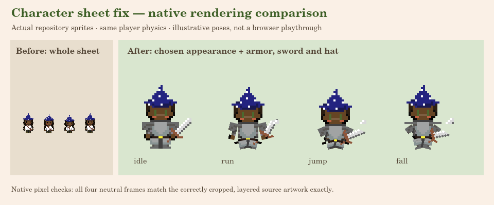

# Game avatar sprite-sheet fix

The Customize renderer now supplies horizontal sprite sheets through `stageLayers` (`count: 4`), plus skin/outfit/eyes/hair layers from the signed-in user's existing appearance metadata. The game was still treating each sheet as one image and omitted the appearance argument. This produced four tiny/squashed frames and the default body instead of the selected look.

## Changes

- `rendering/AvatarRenderer.js`: pass the current account's existing appearance into the shared layer builder; select one sheet frame; keep all body/equipment layers on the same frame clock. Preserve old separate-image frames, pixel scaling, facing, Reduce Motion, death anchors and optional-item fallback. Require all chosen body parts before using a partial avatar. Reject obsolete account loads.
- `rendering/AvatarRig.js`: map the chosen 32px source frame into the established 128px joint coordinates. Limb pivots and player physics are unchanged.
- `tests/avatar-renderer.test.mjs` and `tests/helpers/masterIntegration.cjs`: frame bounds, layer registration, legacy assets, all pose states, account metadata, missing layers, sign-out and racing account loads.

No shop assets, avatar builder, saved data, Supabase implementation, level layout or collision dimensions were modified.

## Manual test

1. Sign in, choose a distinctive skin, hair and eyes in Customize, and equip owned armor, a sword and a hat.
2. Open Adventure. Confirm one correctly sized character appears and its look matches Customize.
3. Walk both ways, stand still, jump, fall, land and climb. Equipment must stay registered with the body; it must not display four copies side by side.
4. Test death/restart and Reduce Motion. The existing character animations and controls should remain intact.
5. Change appearance/equipment and reopen Adventure. Sign out and switch accounts to check that another user's look never carries over.

## Visual evidence

This is native canvas rendering, using the current repository sprites and illustrative poses. It is not a browser screenshot or playthrough. A native pixel comparison verified that all four neutral frames reconstruct exactly the correctly cropped and layered Customize artwork, including armor, sword and hat. Animated pose/frame cropping is covered by automated tests; final visual approval remains the player's.

Validation: `npm test -- --test-concurrency=4` passed all **299 tests**. The initial unrestricted run hit the existing audio integration subprocess's 20-second timeout; the complete rerun used four workers without skipping tests or changing any timeout. The standalone account/avatar integration scenario also passed. `npm run validate:levels` passed all ten levels at 30/60/120 FPS. Native comparison verified all four selected frames byte for byte. Browser gameplay inspection remains outstanding.
