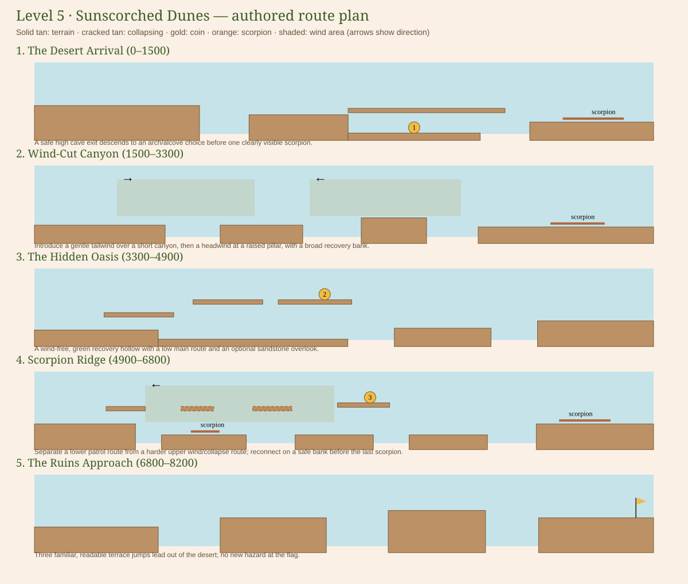
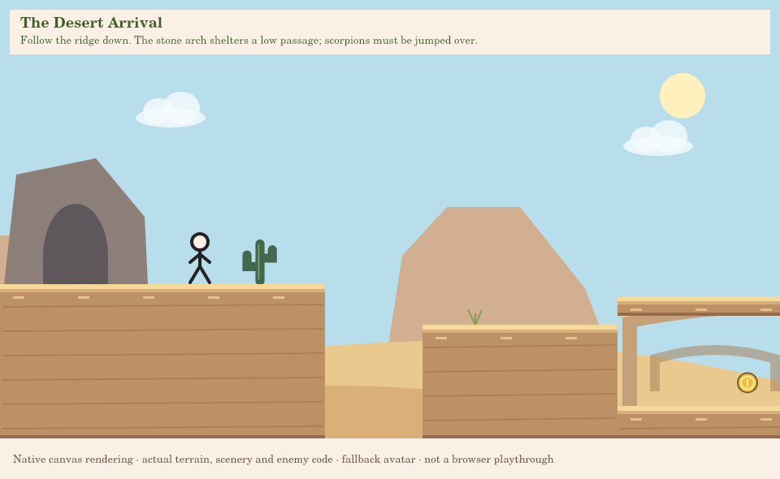
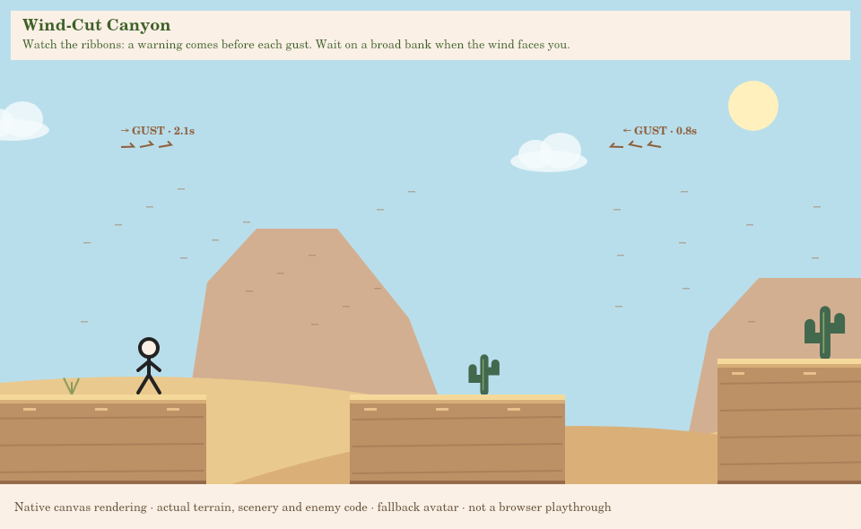
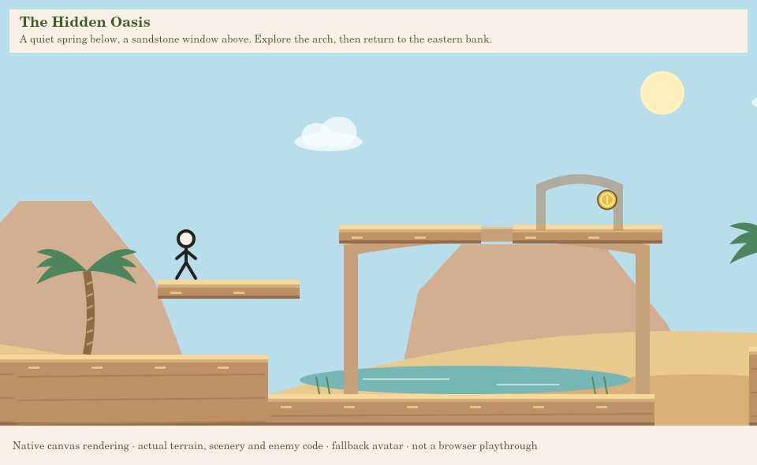
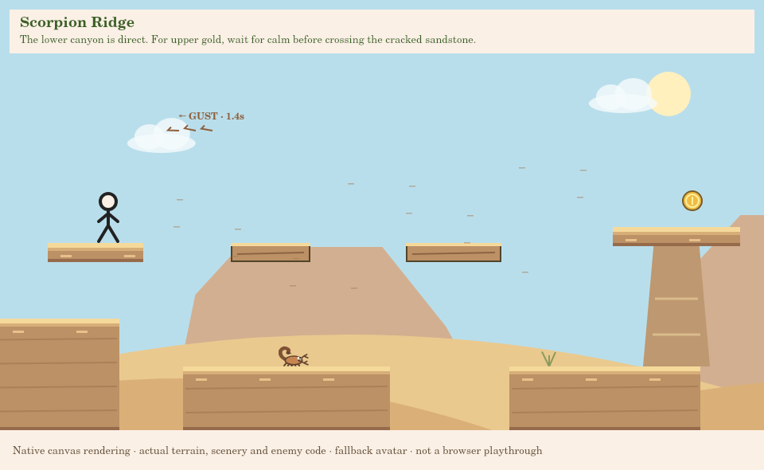
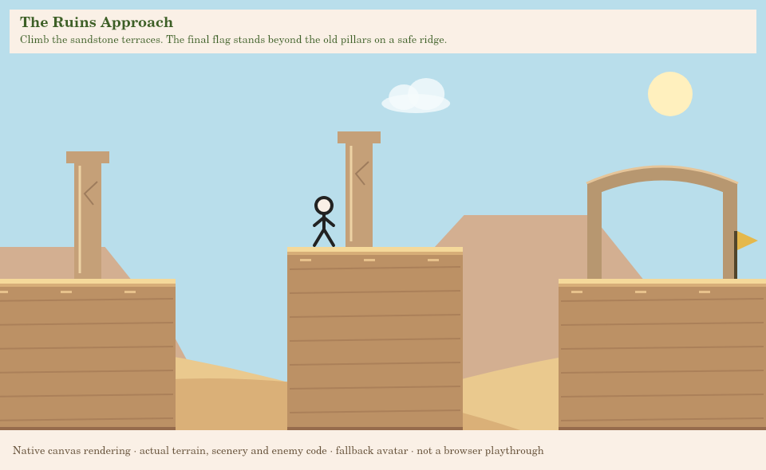

# Level 5: Sunscorched Dunes

Implemented on `game-prototype`, pending your personal gameplay/visual/audio approval.
No Level 6, database, authentication or coin-storage changes. Nothing is pushed or
merged for this task without permission.

## Design and route plan

The course is **8,200px** instead of another 16,000–18,000px repetition. Its terrain
uses seven heights (y285–500 on routes, y310–500 on banks), descending into sheltered
hollows before climbing toward the ruins. Every collider is rectangular. Dunes,
arches, pillars and apparent slopes are cosmetic; there is no new slope physics.

The existing 280px/s run, 650 jump and 1800 gravity yield about 108–115px jump rise
and 200px same-height travel across tested frame rates. Wind changes horizontal
travel, not jump strength or gravity. Camera and character customization are shared.

| Section | Coordinates | Main route and reason for its terrain | Optional/recovery design |
| --- | --- | --- | --- |
| Desert Arrival | 0–1500 | High cave-exit terrace y350, separated shoulder y400, natural arch and east bank y440. The first gap occurs before the first enemy. | Drop beneath the arch into a real low alcove at y500 for Coin 1; jump out at the far lip. The upper arch bypasses it. An isolated scorpion comes after clear landing space. |
| Wind-Cut Canyon | 1500–3300 | Broad lookout, a 160px tailwind introduction, a raised sandstone pillar, then a lower recovery bank. Gaps range 150–170px. | Tailwind ends early enough to leave a wind-free observation pad on the west bank. Wait near x2220 for the headwind to settle. The next scorpion is well after the landing. |
| Hidden Oasis | 3300–4900 | A low sheltered basin, decorative pool and eastern terraces. No wind or enemies. | Three upper rock ledges form a sandstone arch/window overlooking the water; Coin 2 rewards that route. Palms are widely spaced. Both routes rejoin the east bank. |
| Scorpion Ridge | 4900–6800 | Lower banks provide a direct route past a short, predictable scorpion patrol. A thorn patch announces the optional upper departure. | Wait outside the wind on x5120–5240/y305. Two collapsing slabs cross a patrol and a real pit, leading to Coin 3. Dropping after the reward rejoins at x6050/y460, too low to bypass the reward from underneath. A separate safe landing precedes the last scorpion. |
| Ruins Approach | 6800–8200 | Separated sandstone terraces climb y400 → 350 → 310, then descend to the y350 flag bank. | Familiar jumps, no new hazards, a clearly visible final arch and safe flag. Ruined pillars suggest Level 6 without implementing it. |

## Collectibles and exploration

| Coin | Stable ID | Position | How to reach it |
| --- | --- | --- | --- |
| Easy | `level-5-coin-1` | x920/y470 | Descend into the Sheltered Hollow beneath the arrival arch. |
| Medium | `level-5-coin-2` | x4050/y255 | Climb the three oasis rock ledges, enter the sandstone window, then return to the east bank. |
| Hard | `level-5-coin-3` | x5930/y255 | Use the upper ridge's cracked slabs, controlling takeoff timing against the headwind. Drop to the lower rejoining bank afterward. |

All three detours have declared entrances, discovery surfaces and safe exits.
The alcove is an actual lower passage, the oasis route overlooks a distinct pool,
and the ridge route bypasses a patrol rather than merely hiding a shelf with a bush.
New collectibles still bank **only at the flag**. Death/map abandonment discard them;
already earned coins remain faded. These achievements never affect shop currency.

## Wind and scorpions

`engine/Wind.js` owns only attempt-local gust time and horizontal drift. A zone
configures its rectangle, direction (+1/-1), strength, and optionally a predictable
period/warning/duration/offset. Omit the period for constant wind. The maximum
configured drift is bounded at 120px/s; this course uses 60–85px/s. Ground drag
reduces the force to 20%. A short exponential response builds force gradually;
small bounded force steps make the clock/acceleration consistent across rates.

`stepLevel` applies that displacement before the existing gravity/landing and swept
wall/gate collision paths. Fly Mode ignores wind; pause stops the gameplay clock;
restart clears gust time and drift. There is no separate collision engine.

| Zone | Bounds (x) | Direction/strength | Period | Purpose |
| --- | --- | --- | --- | --- |
| First tailwind | 1740–2140 | Right / 60 | 5.8s | Gentle first crossing, with clear observation space afterward. |
| Canyon headwind | 2300–2740 | Left / 75 | 6.4s | Read the ribbons before jumping to the raised pillar. |
| Ridge wind | 5240–5820 | Left / 85 | 6.6s | Narrow the optional upper jumps' margin while keeping the lower path independent. |

Each periodic zone has a 0.9s warning, 2.4s gust, short force ramps and a calm
interval. Arrows, ribbon movement, sand streaks, phase text and a countdown identify
what is happening. Reduce Motion keeps direction/state text and static indicators.
Observation positions x2220/y440 and x5180/y305 remain still through full gust cycles.

The scorpion is a new appearance in the existing Enemy class: four small orange
patrols, at x1350, 3060, 5410 and 6540 initially. It is **not stompable**. Side,
underside and top contact are lethal. No chasing, poison, projectiles or new AI.

## Music and presentation

The desert uses `audio.music: "desert"`: **Ribbons over Sandstone**, an original
24-bar, 60-second, 96 BPM score. Plucked answers, a playful reed melody and quiet
syncopated percussion distinguish it from grasslands. Its middle phrase drops the
reed for a lower, more open harp answer. It uses existing synth voices and the same
volume, asynchronous preparation, pause and scene-transition behavior. The listening
room automatically includes it as its sixth track. Earlier arrangements and all
existing effect samples retain their baseline hashes.

Native canvas previews below use actual game renderers and the fallback avatar.
They are **not browser screenshots** or proof of actual account equipment rendering.

## Executed automated checks

- `npm test`: **205 passing tests**, no skipped tests.
- `npm run validate:levels`: all five levels pass structural checks, local jump
  graphs, all-coin routes, coin-free routes and local exploration witnesses at
  **30, 60 and 120 FPS**.
- Six new full spawn-to-flag input traces retain all enemies, thorns, gusts and
  collapse timers. Three all-coin traces visit all three detours and both cracked
  slabs; three main-route traces avoid the detours and cracked slabs entirely.
- Nine local secret traces establish entrance → reward → safe return. Those are
  separate from the full-course proofs, with no flight, invincibility or teleportation
  during either continuous route.
- Targeted tests cover constant/periodic force integration, countersteering, moving
  platform compatibility, solid-wall blocking, safe observation, warning/collapse/reset,
  scorpion collisions and patrol bounds, lower-route coin-shortcut prevention,
  persistence, account isolation and developer no-save rules.
- The same optional ridge takeoff lands on the upper reward during calm, but on
  the safe lower bank during a headwind. This gives wind a demonstrated gameplay
  consequence rather than only a decorative effect.
- The actual game-entry harness, with DOM/auth/audio boundaries mocked, verifies
  active gust freeze/resume, menus, saves, replay, Cave → Desert Next navigation,
  desert music selection, map abandonment and unavailable Level 6 behavior.
- Baselines preserve all four earlier level configs and earlier five arrangements;
  the original route/saving/customization/developer regression suite remains active.

Optimized input traces finish this compact level in about **29 seconds**, with
or without coins. This establishes feasibility, not a promise of human playtime.
Exploration, waiting, mistakes and first-time learning still need your assessment.

## Test in VS Code

1. After these changes are published with permission, pull `game-prototype` into
   your existing checkout. Keep your current browser origin (hostname and port):
   progress is account-specific **and origin-specific**.
2. Start your existing local server, or from the repository root run
   `python game/scripts/serve-development.py`. Open `http://127.0.0.1:8000/game/`
   (use your existing origin instead if your saves live on another host/port).
3. Sign in normally. Complete Crystal Cave, then choose Next Level or select
   **5: Sunscorched Dunes** on the map. Existing completed Cave accounts can select it
   immediately. Completing Desert unlocks 6 in progress data, but 6 stays unplayable.
4. With Developer Mode off, play once without detours. Look for fair takeoffs,
   visible landing space, warning readability, safe waiting and a calm final flag.
5. Replay for the three coins. On the ridge, compare an early gust jump with waiting
   for calm on the departure ledge. Do not wait on a cracked slab.
6. Pause during a gust and a collapse warning; check that both resume from the same
   state. Die, press R and replay; check gusts, enemies and slabs reset.
7. Collect a new coin then die or leave: it should not bank. Finish with it, refresh,
   and replay: it should remain credited/faded. Check another account stays separate.
8. After Level 5 completion, Next Level must say Coming soon and not load Level 6.
   Replay and World Map should work normally. Check music pause, mute and sliders.
9. For listening comparisons or locked-level inspection only, restart the server
   with `python game/scripts/serve-development.py --dev-tools`. Open
   `/game/dev/music-preview.html` to audition the desert track.

## Developer inspection destinations

Pause → Settings → Developer Mode → Enable Developer Tools → Admin Tools → choose
Level 5. Destination names below are already generated from level configuration;
no new developer screen is required. Teleport/flight/locked-level testing marks the
attempt TEST RUN and prevents legitimate coin/progression saves. Use ordinary
unassisted play for acceptance and saving tests.

| Destination | Nearby world position | Inspect |
| --- | --- | --- |
| Level Start | x96/y350 | Cave exit, descending terrace, clearly visible first gap. |
| Secret Entrance: The Sheltered Hollow | x685/y400 | Low alcove below the arch and safe far-lip exit. |
| Secret Entrance: The Quiet Spring | x3445/y450 | Pool, spaced palms and the sandstone window route. |
| Final Challenge: Scorpion Ridge | near x4932/y400 | Thorns, upper departure and separate lower patrol. |
| Secret Entrance: The Windward Cache | x4945/y400 | Wait on the upper departure before committing to the cracked route. |
| Coin 3 | near x5930/y285 | Upper reward and lower rejoining bank; no shortcut from underneath. |
| Finish Flag | near x8110/y350 | Ruin arch, safe finish and completion buttons. |

For the canyon, fly to the bank around x2220/y440, turn flight off to place safely,
and inspect the ribbons before testing ordinary jumps. This remains an assisted
run; restart from a normally unlocked map level with tools off for a legitimate save.

## Limits and approval

Chromium cannot launch in this execution environment. The five native renders were
visually inspected; automated route proofs use real movement inputs and physics,
but are **not human/browser playtesting**. Audio was validated mechanically, not
listened to here. Your approval of feel, difficulty, camera readability, actual
customized character appearance, soundtrack and first-play pacing is still required.
The water is cosmetic and wind is horizontal only. Level 6 is not implemented.

## Added and modified files

| File | Responsibility |
| --- | --- |
| `game/audio/MusicScores.js` | Original desert composition using existing synth voices and playback. |
| `game/dev/DebugRenderer.js` | Display wind rectangles with existing hitbox tools. |
| `game/dev/music-preview.html` | Update listening-room copy for six registered scores. |
| `game/docs/BIOME_MUSIC_REVIEW.md` | Design, manual testing, locations, evidence and guide navigation. |
| `game/docs/LEVEL5_PLAYTEST.md` | Design, manual testing, locations, evidence and guide navigation. |
| `game/docs/README.md` | Design, manual testing, locations, evidence and guide navigation. |
| `game/docs/level5-arrival.png` | Actual-renderer preview or exact scaled layout diagram. |
| `game/docs/level5-canyon.png` | Actual-renderer preview or exact scaled layout diagram. |
| `game/docs/level5-layout.svg` | Actual-renderer preview or exact scaled layout diagram. |
| `game/docs/level5-oasis.png` | Actual-renderer preview or exact scaled layout diagram. |
| `game/docs/level5-ridge.png` | Actual-renderer preview or exact scaled layout diagram. |
| `game/docs/level5-ruins.png` | Actual-renderer preview or exact scaled layout diagram. |
| `game/engine/Wind.js` | Reusable gust clock, gradual horizontal force, reset and config validation. |
| `game/engine/stepLevel.js` | Apply wind before existing landing/wall collision; flight bypasses force. |
| `game/game.js` | Select desert renderer, draw wind and show accurate scorpion instructions. |
| `game/index.html` | Update map node 5 name/unlock label and instruction span. |
| `game/levels/Level5.js` | Five authored sections, terrain, scorpions, gust zones, detours and stable coins. |
| `game/levels/Level5Scenery.js` | Hand-positioned desert landmarks and spaced palms. |
| `game/levels/LevelManager.js` | Own and reset attempt-local wind state. |
| `game/levels/design/defineLevel.js` | Flatten optional per-section wind zones. |
| `game/levels/design/validateExploration.js` | Accept the sandstone window presentation kind. |
| `game/levels/design/validateLevel.js` | Validate wind definitions and global IDs. |
| `game/levels/levels.js` | Register Level 5 for map, progression and developer tools. |
| `game/rendering/DesertRenderer.js` | Desert background, landmarks, pool and visible wind states. |
| `game/rendering/EnemyRenderer.js` | Simple animated scorpion appearance. |
| `game/rendering/ExplorationRenderer.js` | Rock-window exploration veil, rather than forest foliage. |
| `game/rendering/GrasslandRenderer.js` | Opt-in sandstone terrain material; earlier materials unchanged. |
| `game/rendering/PlatformRenderer.js` | Sandstone collapse material and warnings. |
| `game/rendering/SceneryGeometry.js` | Include palm crown bounds in existing spacing validation. |
| `game/tests/audio.test.mjs` | Wind/desert tests or registry-aware extension of existing regression/UI/audio checks. |
| `game/tests/biome-music.test.mjs` | Wind/desert tests or registry-aware extension of existing regression/UI/audio checks. |
| `game/tests/coin-reset.test.mjs` | Wind/desert tests or registry-aware extension of existing regression/UI/audio checks. |
| `game/tests/developer.test.mjs` | Wind/desert tests or registry-aware extension of existing regression/UI/audio checks. |
| `game/tests/exploration.test.mjs` | Wind/desert tests or registry-aware extension of existing regression/UI/audio checks. |
| `game/tests/fixtures/exploration-routes.json` | New desert route/baseline fixture or appended Level 5 exploration witnesses; earlier witnesses retained. |
| `game/tests/fixtures/level5-main-routes.json` | New desert route/baseline fixture or appended Level 5 exploration witnesses; earlier witnesses retained. |
| `game/tests/fixtures/level5-routes.json` | New desert route/baseline fixture or appended Level 5 exploration witnesses; earlier witnesses retained. |
| `game/tests/fixtures/pre-desert-baseline.json` | New desert route/baseline fixture or appended Level 5 exploration witnesses; earlier witnesses retained. |
| `game/tests/helpers/pauseGameHarness.cjs` | Wind/desert tests or registry-aware extension of existing regression/UI/audio checks. |
| `game/tests/level3.test.mjs` | Wind/desert tests or registry-aware extension of existing regression/UI/audio checks. |
| `game/tests/level4.test.mjs` | Wind/desert tests or registry-aware extension of existing regression/UI/audio checks. |
| `game/tests/level5.test.mjs` | Wind/desert tests or registry-aware extension of existing regression/UI/audio checks. |
| `game/tests/map.test.mjs` | Wind/desert tests or registry-aware extension of existing regression/UI/audio checks. |
| `game/tests/other-level-quality.test.mjs` | Wind/desert tests or registry-aware extension of existing regression/UI/audio checks. |
| `game/tests/platform-purpose.test.mjs` | Wind/desert tests or registry-aware extension of existing regression/UI/audio checks. |
| `game/tests/stomp.test.mjs` | Wind/desert tests or registry-aware extension of existing regression/UI/audio checks. |
| `game/tests/wind.test.mjs` | Wind/desert tests or registry-aware extension of existing regression/UI/audio checks. |
