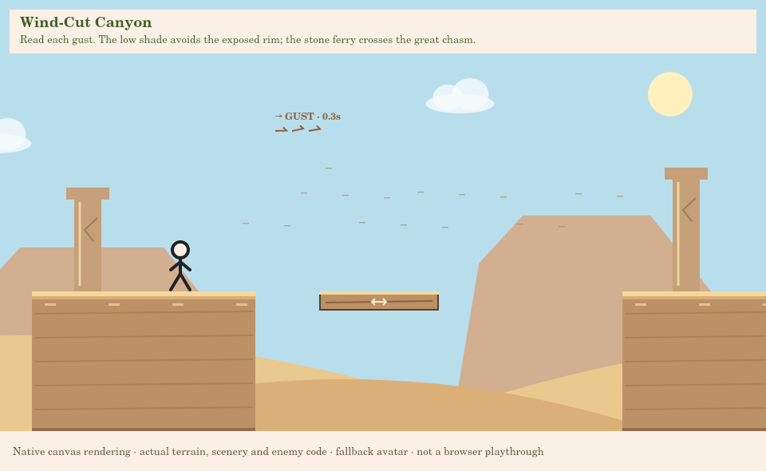
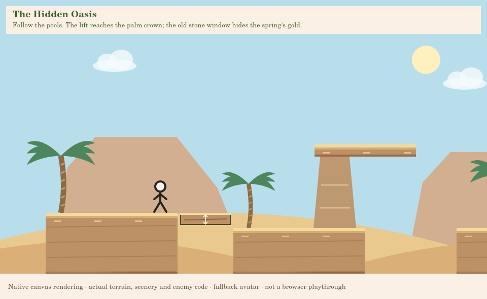
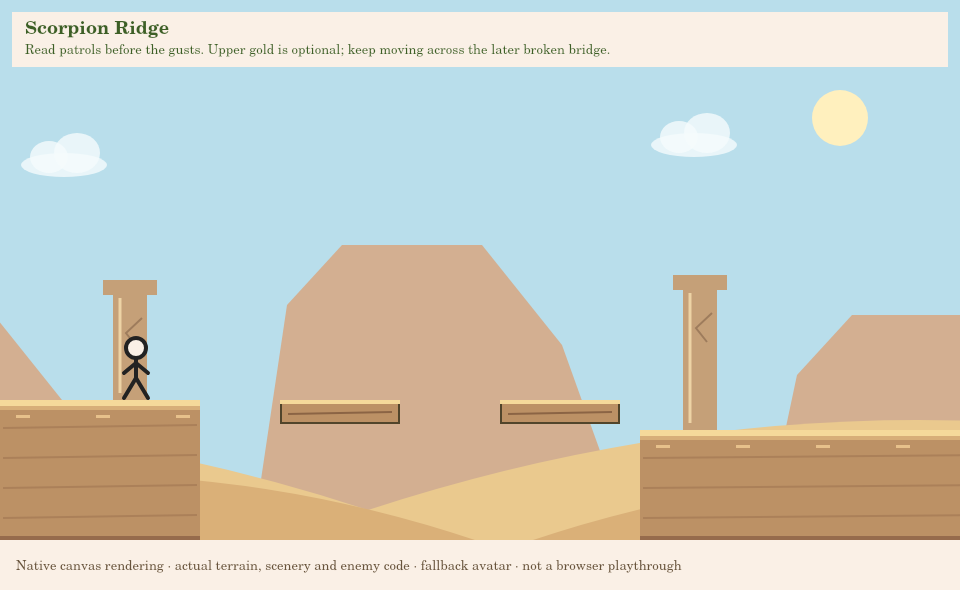

# Level 5: Sunscorched Dunes — expanded adventure

This 22,000px revision supersedes the original 8,200px course. It stays on
`game-prototype`, pending your gameplay, visual, difficulty and pacing approval.
No changes to Levels 1–4, player physics, music, account storage or Supabase.
Exactly three achievement coins retain their original IDs and saving rules.
Nothing is pushed or merged for this revision without permission.

## Journey plan


The five major areas contain **18 named encounter beats**, not five copies of a
platform staircase. Terrain spans y285–500 using the existing rectangular landing
surfaces; dunes and apparent slopes remain background art. The shared 280 run,
650 jump and 1800 gravity are unchanged (roughly 108–115px rise and 200px normal
same-height travel at tested frame rates).

| Area | Range | Encounter beats and purpose |
| --- | --- | --- |
| Desert Arrival | 0–4000 | **Cave Exit Ridges:** descend from a high cave mouth through a dry wash, then climb across separated banks. One isolated patrol teaches the scorpion silhouette. **Sheltered Arch:** choose the main arch or low Coin 1 alcove, then meet a second patrol on a broad bank. **Outer Rim:** gentle elevation changes lead into the first wind lesson. |
| Wind-Cut Canyon | 4000–9000 | **Learning the Gusts:** gentle tailwind, headwind pillar and recovery bank. **Rim or Shade:** exposed upper ledge or a genuinely wind-free lower passage. **Great Chasm:** board a stone ferry across a 460px gap; observe from safe banks and ride across. **Exit Fin:** a separate patrol and stronger tailwind-assisted terrain after recovery. |
| Hidden Oasis | 9000–13200 | **Reed Pond:** descend into the first pool district. **Palm Crown:** choose the lower ford or ride a lift to a true elevated overlook. **Quiet Spring:** follow the sandstone window route for Coin 2 above the central water. **Eastern Ford:** a third pool, separated palms and a calm climb out. No enemies or gusts here. |
| Scorpion Ridge | 13200–18200 | **Patrol and Shear:** separate a wash patrol, stronger headwind jump and thorn dell. **Windward Cache:** the optional upper cracked route rewards Coin 3; the lower route remains independent. **Broken Span:** two mandatory collapsing slabs cross a real 440px opening. **Eastern Watch:** recover on a clear bank before a separate approach jump and final patrol. |
| Ruins Approach | 18200–22000 | **Fallen Bridge:** broken masonry and one familiar tailwind crossing. **Outer Court:** wind-free terrain and increasingly visible arches. **Flag Ridge:** a familiar, safe final climb, without a surprise enemy at the flag. |

The longest uninterrupted flat terrain strip is **640px**. Larger ranges above
include multiple distinct jumps, route choices, patrols or movers. Quiet banks
remain intentionally useful for observation and recovery rather than stretching
the length with empty terrain. The source's `beats` data records section coverage.

## Coins and optional routes

| Achievement | Stable ID | New location | Intended route |
| --- | --- | --- | --- |
| Easy | `level-5-coin-1` | x2720/y470 | Descend below the arrival arch into the Sheltered Hollow; jump out at the far lip. |
| Medium | `level-5-coin-2` | x11350/y255 | Explore the central oasis's upper sandstone arch/window, then rejoin the eastern bank. |
| Hard | `level-5-coin-3` | x15930/y255 | Read the headwind, use the optional cracked upper route, then drop to the safe lower return bank. |

All prior permanent coin credit follows the IDs, so relocation does not erase saves.
New coins still bank only at the finish; death or abandonment discards pending
pickups. Earned coins stay faded and cannot duplicate rewards. Shop currency and
account isolation are unchanged.

There are **five** separately validated optional areas:

- Sheltered Hollow: entrance x2460/y400 → lower alcove → return x3010/y440.
- Windless Passage: entrance x5670/y450 → shaded floor x5880–6330/y500 → return x6490/y450.
  The upper wind ends at y390, above this lower route. Choosing shade avoids that
  exposure but does not bypass the later ferry.
- Palm Crown: entrance x9910/y420 → vertical lift → perch x10320–10520/y285 → return x10630/y450.
- Quiet Spring: entrance x10720/y450 → sandstone steps/window → return x11650/y440.
- Windward Cache: entrance x14920/y400 → optional cracked route → return x16150/y460.

All return to stable, safe terrain. Extra exploration areas do not award extra coins.

## Movers, bridges and wind solutions

| Encounter | Geometry / timing | Why it belongs here |
| --- | --- | --- |
| Canyon ferry | x7180/y365, width150, horizontal travel220, speed65, endpoint pause0.45s | The real gap is x7100–7560 (460px). A normal jump cannot replace the ferry. Broad departure/arrival banks allow observation. The light breeze affects airborne boarding/exits, with its bottom above grounded riders' heads. |
| Palm lift | x10055/y420, width100, rises135 to y285, speed55, pause0.4s | Its destination is genuinely higher than a normal jump can reach from the departure bank. It does not duplicate the low ford's function. The movement shaft stays clear of terrain. |
| Optional ridge slabs | x15350 and15570/y305, delay1.2s | One crosses above the lower scorpion; the next crosses a real pit. They lead to the difficult coin rather than duplicating a safe upper staircase. |
| Required broken span | x17080 and17300/y400, delay1.4s | Both stand over the real x17000–17440 opening. Their warning gives room for a late first jump, and a clear recovery bank follows. The next scorpion patrol was moved beyond that recovery, onto the separate eastern approach. |

| Wind zone | Range | Direction/strength | Purpose |
| --- | --- | --- | --- |
| First tailwind | 4240–4640 | Right / 60 | Gentle introductory crossing; a wind-free pad follows. |
| Canyon headwind | 4800–5240 | Left / 75 | Wait and read the pillar crossing. |
| Exposed rim | 5890–6330 | Left / 80 | An upper wind route with a sheltered lower alternative. |
| Ferry breeze | 7080–7570 | Right / 50 | Airborne boarding/exit assistance; height110 leaves grounded riders unaffected. |
| Exit fin | 8260–8790 | Right / 90 | A stronger tailwind jump after a clear waiting bank. |
| Ridge shear | 13960–14470 | Left / 95 | A harder headwind climb, separated from the preceding patrol. |
| Windward cache | 15240–15820 | Left / 85 | Timing and takeoff control on the optional cracked route. |
| Ruin breeze | 18970–19460 | Right / 65 | A familiar final application before the quiet outer court. |

All use the already implemented warning/gust/calm clock, gradual force and reset.
Pause freezes that clock. Existing directional ribbons, state/countdown text, sand
streaks and Reduce Motion behavior are preserved. Safe waiting positions include
x4720/y440 and x15180/y305. No new movement ability or hazard system was introduced.

## Rendered views

These previews use the actual terrain/scenery/enemy rendering code and fallback
avatar. They were visually inspected, but are **not browser screenshots** or
proof of human playtesting/customized equipment appearance.









The background now has enough explicitly authored mesa/cloud landmarks for the
entire journey. Palm canopy spacing is validated; the scenery builds from sparse
ridges through three pool districts to increasingly frequent ruin columns.

## Automated validation and performance

Executed for this expanded revision: **210 tests pass**, with no skips. All five
levels pass structural, route and exploration validation at **30/60/120 FPS**.
Commands:

```sh
npm test
npm run validate:levels
```

The suite preserves earlier levels' baseline hashes, earlier soundtracks, account
progress, audio, pause, developer tools and shared physics tests. Revised route
fixtures use ordinary left/right/jump/wait inputs, retaining every live enemy,
wind zone, gap, thorn and platform timer. No flight, invincibility, teleportation
or hazard removal is used to make successful continuous traces pass.

- Full spawn → all three coins → flag and spawn → zero coins → flag traces at
  30/60/120 FPS. Main traces avoid all five optional discoveries and the optional
  coin slabs, while still crossing the required ferry and broken span.
- Fifteen separate entrance → discovery/reward → safe return witnesses at those rates.
- Ferry and lift boarding/ride/exit at three arrival phases per rate; ferry riders
  remain supported through reversal. A negative control proves the dock jump alone
  cannot cross the chasm.
- A late first warning jump crosses the required broken span at each rate. Resets
  restore every mover, slab, patrol and gust clock.
- The wind tests retain their identical-input calm/headwind comparison on the
  relocated coin route. Safe observation spots stay still through full cycles.
- A pacing check verifies eighteen contiguous encounter beats, gradual area
  boundaries, spread-out coin locations and no flat terrain strip over 700px.

A local diagnostic run of the complete coin-free traces took 21.2ms, 20.1ms and
28.6ms of CPU time for 2,542 / 5,088 / 10,177 simulated ticks respectively
(30 / 60 / 120 FPS traces). A separate native-canvas sweep of 240 views across the
course measured 0.525ms mean and 1.068ms 95th-percentile rendering time. These
include real level entities/materials, but use a fallback avatar and native canvas.
They are not portable browser performance thresholds or a performance promise.

Frame-rate route success is not a browser frame-time measurement. Local CPU/native
renderer measurements, when reported, are diagnostic throughput only; they do not
establish browser FPS or responsiveness on your machine.

## First-play duration and approval

The requested first-successful-playthrough target is **5–8 minutes**. At 280px/s,
22,000px has a theoretical straight-line minimum of about 79 seconds before stops,
route choices, backtracking and mistakes. Optimized traces are reported separately;
the new all-coin traces take **85.6–85.8 seconds**, and coin-free traces take
**84.7–84.8 seconds**. They are **not** a claim that the human pacing target was achieved. There are no
artificial countdown waits, walking-speed reductions or empty padding to force it.
Your first-play observations are required to judge the target and difficulty.

Chromium launch was attempted and failed with `socket() failed: Operation not
permitted`. Native renders were inspected, and normal-input gameplay was simulated,
but no actual browser playthrough or listening session is claimed here. The long
no-checkpoint attempt and restart difficulty especially need your feedback.

## Test in VS Code

1. After this revision is pushed with permission, pull `game-prototype`. Keep the
   same browser hostname/port used for your saves; changing origin uses separate
   storage without deleting the old account's achievements.
2. Start your existing server, or run
   `python game/scripts/serve-development.py` from the repository root. Open
   `http://127.0.0.1:8000/game/` (or your existing origin).
3. Select Sunscorched Dunes after completing Crystal Cave. For acceptance tests,
   leave Developer Mode off. Check arrival difficulty, safe waiting, directions,
   the shaded alternative, ferry boarding and a calm oasis break.
4. Finish once without detours, then replay for all three coins. Compare the
   windward route during a headwind and calm. Judge the long ridge's recovery
   spacing and whether the ruin approach feels satisfying rather than repetitive.
5. Pause during a gust, ferry/lift ride and collapse warning. Retry after death,
   press R and replay; all temporary state must reset. New coins must save only
   after the flag. Previously earned coins, other levels and other accounts must
   retain their correct progress.
6. Record your approximate time from first launch to first success, and the duration
   of the successful attempt itself. Note any dull stretch, blind landing, awkward
   boarding, repeated-feeling jump or overly punishing restart.

For inspection only, run
`python game/scripts/serve-development.py --dev-tools`, then Pause → Settings →
Developer Mode → Admin Tools → Level 5. Teleport/flight marks the attempt assisted
and prevents legitimate progress saves. Return through the normal map with tools
off for an eligible run. The existing music preview remains available at
`/game/dev/music-preview.html`; the desert score is unchanged.

| Inspection destination | Approximate location | What to check |
| --- | --- | --- |
| Level Start | x96/y350 | New introductory ridges before the old arch. |
| Secret Entrance: The Sheltered Hollow | x2485/y400 | Coin 1 and its low route/return. |
| Secret Entrance: The Windless Passage | x5695/y450 | Upper exposed rim versus lower protected passage. |
| Canyon ferry (fly nearby, then turn flight off) | x7060/y365 | Waiting, boarding, riding, reversing and far-bank exit. |
| Secret Entrance: The Palm Crown | x9935/y420 | Lift shaft and real high destination. |
| Secret Entrance: The Quiet Spring | x10745/y450 | Central oasis/window and Coin 2. |
| Final Challenge: Scorpion Ridge | near x13232/y400 | New patrol/shear sequence before the old coin route. |
| Secret Entrance: The Windward Cache | x14945/y400 | Coin 3 route, wind timing and lower return. |
| Required broken span (fly nearby, then turn flight off) | x16920/y400 | Warnings, late jumps, real pits and safe recovery. |
| Finish Flag | near x21910/y350 | Final ruins, flag, replay/map and unavailable Level 6. |

## Files changed in this expansion

- `levels/Level5.js`: 22,000px layout, eighteen beat descriptions, two extra optional
  areas, eight patrols, varied winds and deliberately connected movers/bridges.
- `levels/Level5Scenery.js`: spaced landmarks, three pool districts and ruin transitions.
- `rendering/DesertRenderer.js`: accept the course's extended authored background landmarks.
- `tests/level5-expansion.test.mjs`: pacing, ferry/lift phases, necessary ferry
  crossing, late bridge escape and reset tests.
- `tests/level5.test.mjs`, `tests/wind.test.mjs`: revised coordinates and stronger
  route/discovery requirements for the expanded course.
- `tests/fixtures/level5-routes.json`, `level5-main-routes.json`,
  `exploration-routes.json`: revised real-input witnesses; earlier levels retained.
- `tests/exploration.test.mjs`, `platform-purpose.test.mjs`,
  `helpers/pauseGameHarness.cjs`: five optional areas, added interactive-platform
  counts and actual active-gust pause setup at the relocated canyon.
- `docs/LEVEL5_PLAYTEST.md`, `level5-layout.svg`, `level5-*.png`: revised plan,
  testing guide, diagram and representative renderer previews.
