# Level 6: The Lost Sun Temple

**Status:** Implemented on `game-prototype`, awaiting your gameplay, visual,
puzzle and difficulty approval. Not merged. Levels 7–10 are not implemented.
Supabase, player movement, account storage and Levels 1–5 layouts remain unchanged.

## Full journey and encounter plan

**World length: 23,500 pixels.** Five connected regions contain eighteen authored
encounter beats. The shared movement values remain run 280, jump 650, gravity 1800,
player 32×64. Measured normal jumps rise 108–115px and travel about 200px at equal
height. Critical elevated surfaces stay at y285 or lower on screen, inside the
existing horizontal-only camera's usable view. Terrain is rectangular masonry;
background dunes are not falsely presented as physical slopes.

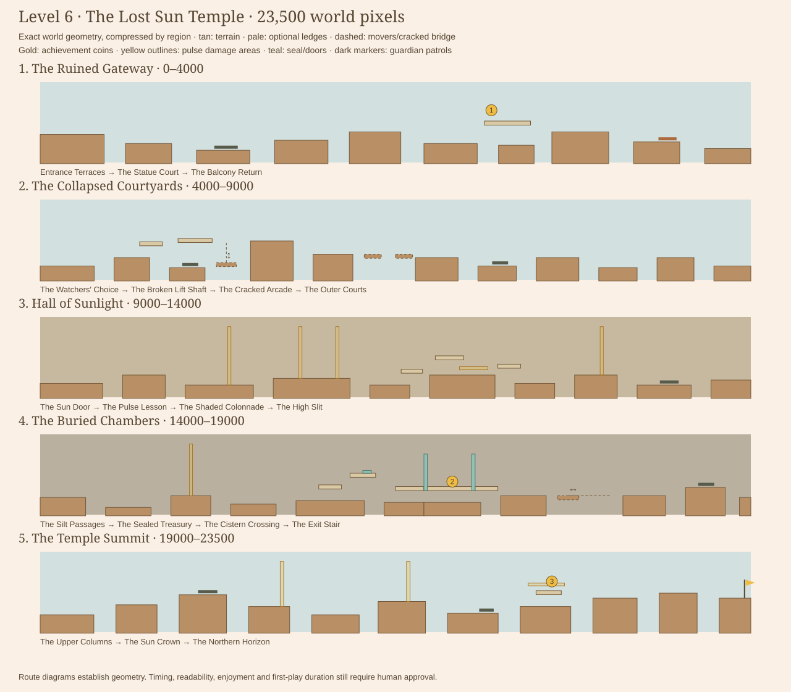

| Area | Exact world range | Encounter beats and gameplay purpose |
| --- | --- | --- |
| The Ruined Gateway | 0–4,000 | **Entrance Terraces:** descend broken entrance masonry and meet one guardian in a visible low court. **Statue Court:** regain height, then descend beside a backward-facing balcony. **Balcony Return:** the overlook reveals a return jump for Coin 1; an outdoor scorpion has a separate, broad bank. |
| The Collapsed Courtyards | 4,000–9,000 | **Watchers' Choice:** guardian court or higher balustrade route. **Broken Lift Shaft:** ride a stone lift to a genuinely higher gallery. **Cracked Arcade:** cross two collapsing bridge slabs over a real chasm. **Outer Courts:** recovery, one separated patrol and a visible stake obstacle before the hall. |
| Hall of Sunlight | 9,000–14,000 | **Sun Door:** a quiet approach establishes the interior. **Pulse Lesson:** observe one beam, then two alternating beams with safe space between. **Shaded Colonnade:** time a low beam and stakes, or explore the upper balcony. **High Slit:** revisit a single pulse, then recover before a guardian court. |
| The Buried Chambers | 14,000–19,000 | **Silt Passages:** descend into older masonry and cross a familiar pulse from a waiting bank. **Sealed Treasury:** optionally climb to a latched Sun Seal and enter its two-door treasure passage. **Cistern Crossing:** ride a stone ferry over a 540px gap. **Exit Stair:** a separate guardian and ascent out of the underground. |
| The Temple Summit | 19,000–23,500 | **Upper Columns:** climb broad pillars and cross a readable pulse. **Sun Crown:** separated patrol, familiar timing and optional pulse-protected final gold. **Northern Horizon:** safe terraces lead to a flag at x23460/y330; distant pale mountain peaks suggest the next region without implementing Level7. |

The longest uninterrupted flat terrace is **700px**, at the quiet hall entrance.
The level includes 69 authored platforms, eight enemies (seven stompable stone
Guardians and one non-stompable outdoor scorpion), nine pulse traps and five
optional areas. These counts describe the implementation, not its quality rating.

## Coins, clues and reconnections

| Stable achievement ID | Center | Intended route and reward |
| --- | --- | --- |
| `level-6-coin-1` | x2540/y220 | Reach the overlook x2880–3200/y350. Turn LEFT to the statue balcony x2500–2760/y285, collect gold, then jump back right and rejoin the outer watch bank. The lower courts cannot jump directly to this balcony or snag its gold. |
| `level-6-coin-2` | x16900/y335 | From the seal court, climb the x15960/y355 step and x16180/y285 balcony. Step on the Sun Seal at x16270. Descend to the x16500/y365 entry, pass the opened left door, collect inside the solid-floor treasury, then leave through the right door and reconnect at x17300/y420. |
| `level-6-coin-3` | x22240/y230 | Wait safely on x22040–22360/y380. Observe the horizontal beam above it. During darkness, jump to the crown x22140/y285, take gold and move to the next column. The beam crosses the upper perch, not the safe waiting bank. |

The five optional areas have explicit entrances, discovery surfaces and exits:

| Area | Entrance x / feetY | Discovery platform(s) | Reconnection x / feetY |
| --- | --- | --- | --- |
| The Turned Sun | 2960 /350 | Statue balcony, Coin 1 | 3400 /410 |
| The Watchers' Gallery | 4580 /400 | Upper courtyard balcony avoids the low guardian; still uses the shared lift | 5540 /300 |
| The Shaded Colonnade | 11400 /460 | Upper hall balcony avoids the low horizontal pulse and stakes | 12400 /450 |
| The Sealed Treasury | 15860 /450 | Sun Seal balcony and sealed treasure passage, Coin 2 | 17300 /420 |
| The Sun Crown | 22060 /380 | Pulse-protected crown, Coin 3 | 22560 /330 |

Exactly three achievement coins use the existing completion-only save flow.
Death/abandonment discards pending pickups; earlier earned coins stay faded and
credited. Replay can earn missing IDs without duplicating rewards. The shop's
spendable currency is separate. Developer-assisted attempts cannot save or unlock.

## Reusable Sun Pulse Traps

`SunPulseTrap` owns attempt-local simulation time, an explicit world-space beam
rectangle, direction and cycle settings. It starts inactive, cools down, visibly
charges, becomes dangerous, then repeats. There is **no proximity trigger**.

The shared tick advances every trap once. Swept player/beam contact is evaluated
only within the active portions of that tick, including frames spanning activation
or deactivation. A fast crossing during a safe interval does not become a false
hit merely because the beam turns on later in the frame. Damage uses the existing
death/coin-discard/restart path. Pause/completion stop gameplay ticks; restart
resets all trap clocks. Invincibility/flight ignore damage while clocks still run.

The renderer shows **DARK · SAFE**, **CHARGING + countdown**, and **PULSE**, with
matching silhouette/brightness changes. Reduce Motion disables shimmer but keeps
those essential warnings. Direction selects the emitter side; the explicit
rectangle remains authoritative for damage and debug hitboxes.

| Trap ID (all prefixed `l6-`) | Beam rectangle x/y/w/h | Direction | Cooldown / warning / active | Safe observation location x/feetY |
| --- | --- | --- | --- | --- |
| lesson-beam | 10320 /110 /22 /350 | down | 3.6 /1.2 /1.2s | 10150 /460 |
| pair-west | 10820 /110 /22 /310 | down | 3.2 /1.0 /1.4s | 10665 /420 |
| pair-east | 11080 /110 /22 /310 | down | 3.2 /1.0 /1.4s; initial delay 2.8s | 10900 /420, between beams |
| low-beam | 11950 /350 /200 /18 | right | 3.8 /1.1 /1.2s | 11820 /400 |
| high-beam | 12940 /110 /22 /290 | down | 3.6 /1.2 /1.2s | 12800 /400 |
| buried-beam | 15050 /110 /22 /310 | down | 3.6 /1.2 /1.2s | 14930 /420 |
| summit-west-beam | 20520 /110 /22 /270 | down | 3.6 /1.2 /1.2s | 20340 /380 |
| summit-east-beam | 21320 /110 /22 /240 | down | 3.6 /1.2 /1.2s | 21170 /350 |
| crown-beam | 22090 /240 /230 /16 | right | 3.8 /1.2 /1.4s | 22060 /380, below beam |

All warnings last at least one second. Main-route traps have clear waiting space,
not an unavoidable enemy stacked onto the same landing point. Alternating beams
leave228px of clear walkway between their damage rectangles.

## Ancient mechanisms

| Mechanism | Configuration | Gameplay purpose |
| --- | --- | --- |
| Stone lift | x5240/y430, width 140, rises130px to y300, speed 55, endpoint pause 0.4s | Connect the low court to a truly higher gallery; its shaft contains no redundant fixed crossing. |
| Cracked arcade | x6280 and6500/y380, width 120 each, collapse delay 1.4s | Cross the actual 6200–6640 chasm, then recover on a broad bank. They cannot collapse onto harmless ground. |
| Sun Seal | Floor plate on upper balcony, x16270/y269/w60/h16 | Latches both matching doors open for the current attempt. No countdown or return dash. |
| Treasury | Solid floor x16700/y365/w360/h24, roof y170; doors x16700 and17036/y170/h219 | The coin genuinely requires opening and entering the passage. Solid masonry prevents collection through the floor; door/roof geometry blocks side and upper bypasses. |
| Cistern ferry | x17640/y420, width 150, travel300px, speed 75, endpoint pause 0.4s | Cross the actual 17560–18100 gap. A normal jump cannot replace the ferry. |

The two treasury doors also support outward egress from their protected sides.
This keeps restored/debug starts from becoming trapped, while rejecting entry
from outside. Existing Cave behavior is preserved. No new switch engine, special
jump ability, inventory item or permanent puzzle state was introduced.

## Visual review and previews

These are **native canvas previews using the actual renderer code**, not browser
screenshots. They use the fallback avatar rather than a signed-in user's equipped
art. Trap/puzzle states are staged to show their appearance. They were visually
inspected; they do not prove browser controls, human enjoyment or load performance.

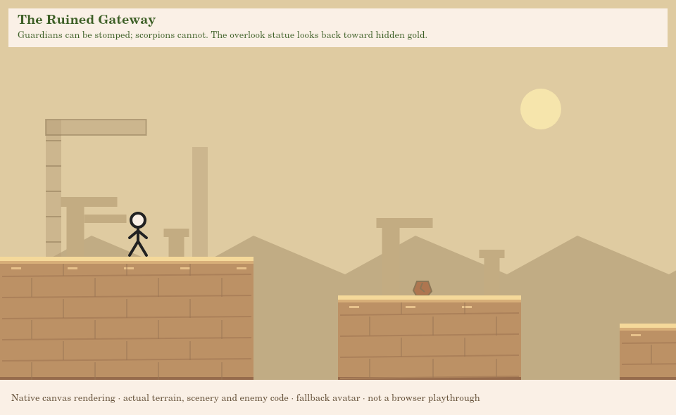
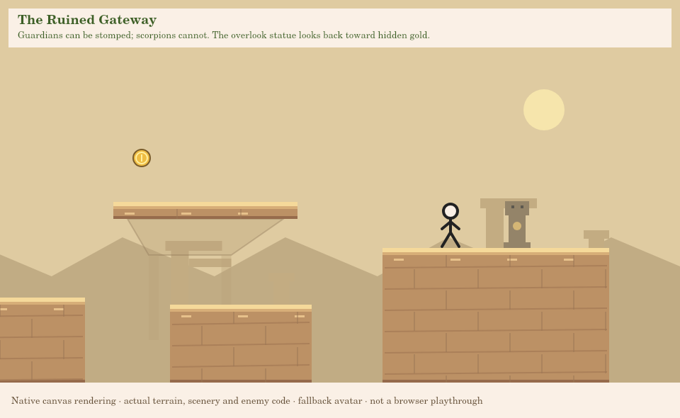
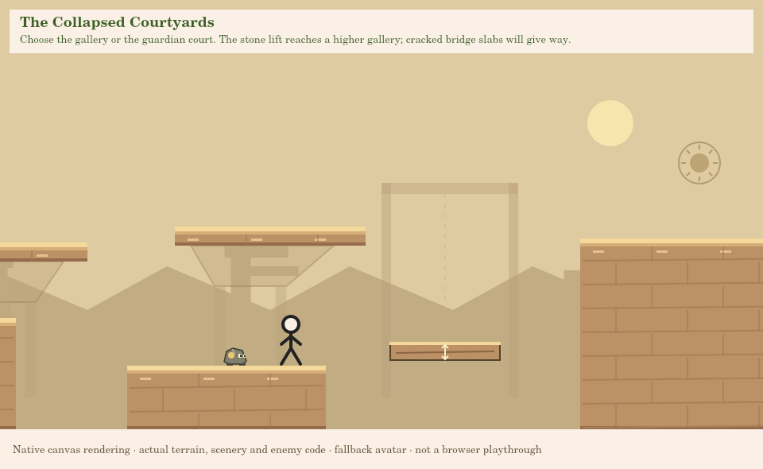
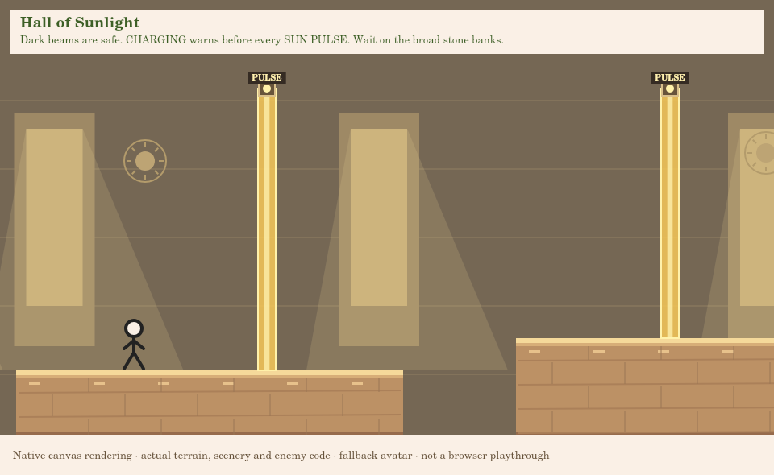
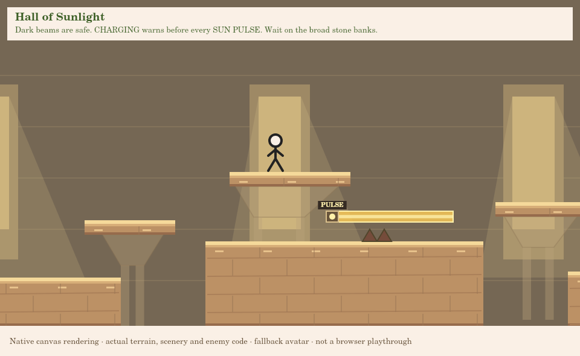
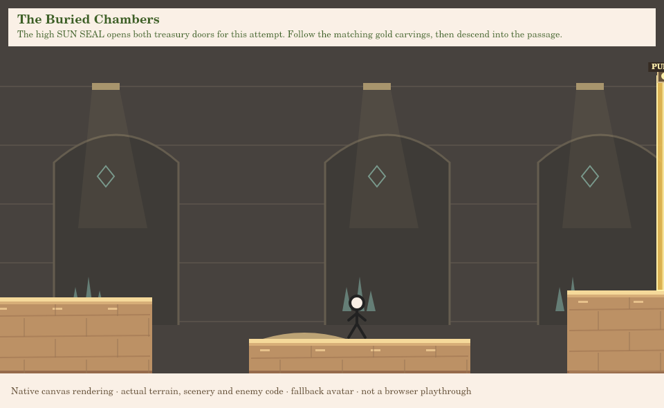
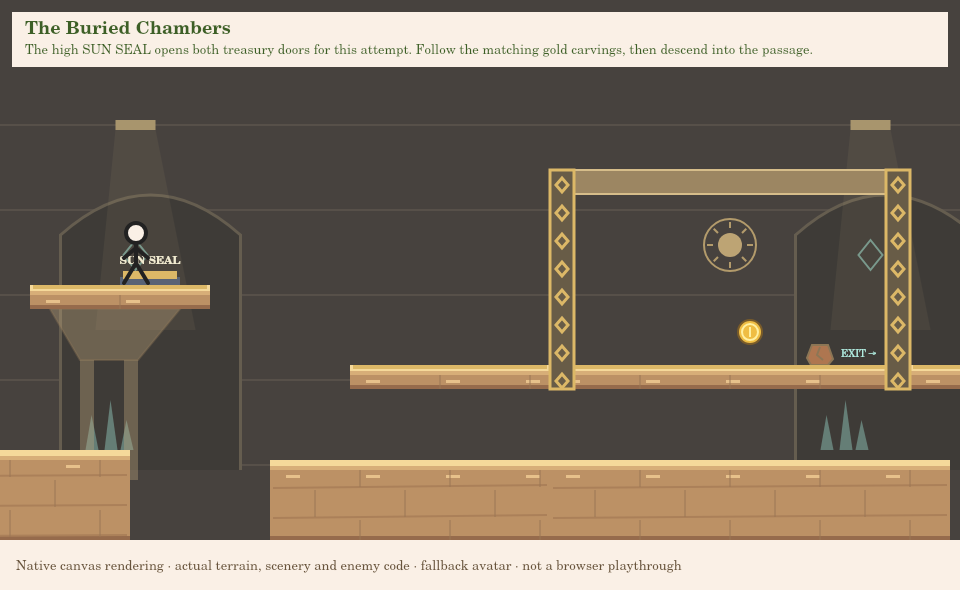
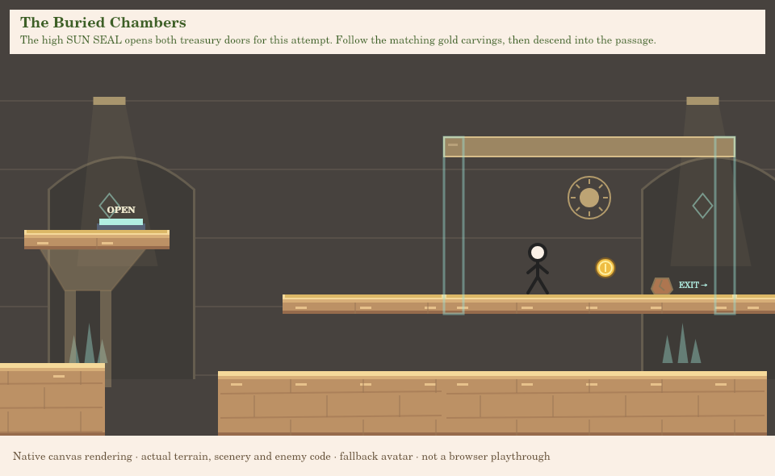
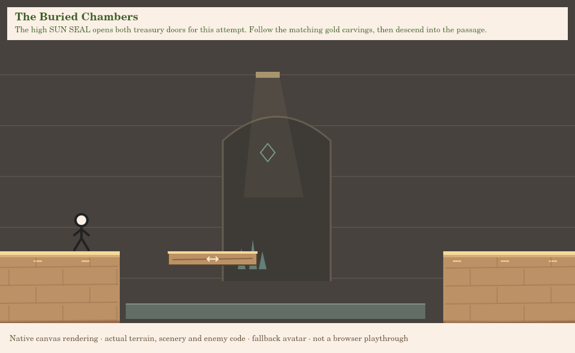
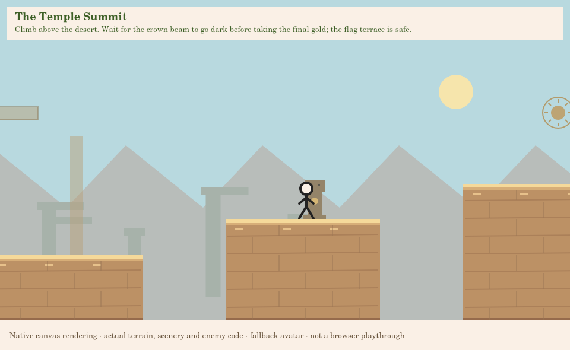
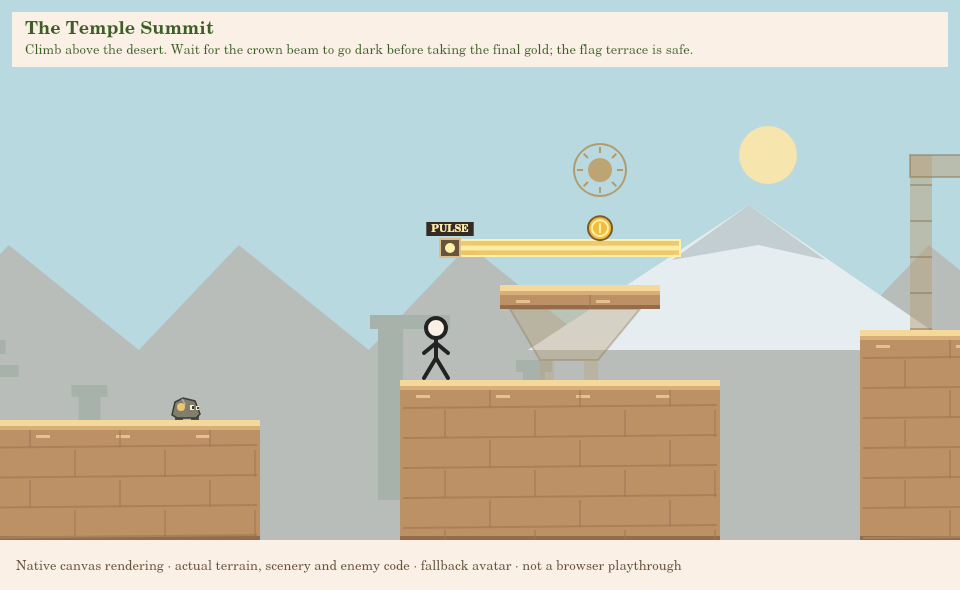
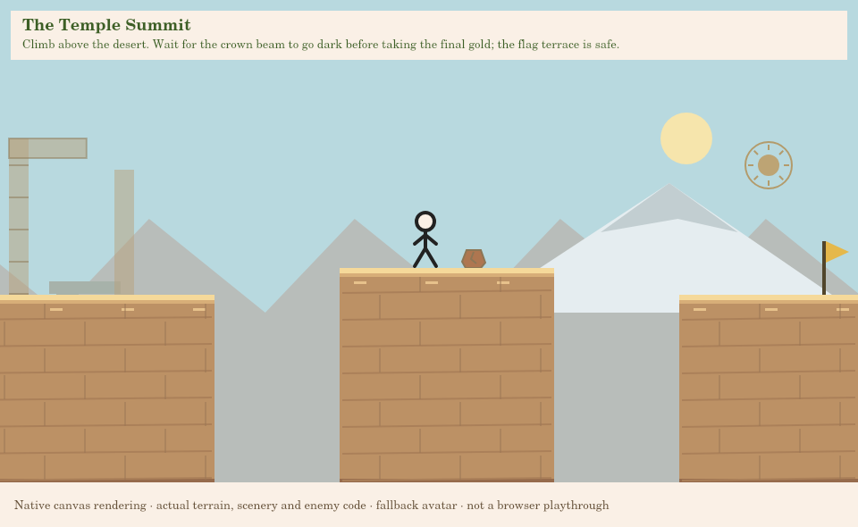

## Original music and navigation

**The Sun Beneath the Stone** is a new original 24-bar, 4/4 arrangement at 88 BPM
(about 65.45s per loop), using reed, harp, soft hand drum, pad and sparse bells.
Its measured rhythm and minor melody differ from the desert track; the middle
phrase opens up and the final phrase varies the return. It uses the existing
worker/preparation, music-channel volume, fades, pause, completion and map flow.
The developer listening room now offers seven arrangements, including the temple.

Completing Level 5 unlocks Level6. Its map selection has the temple name and three
coin indicators. Completing 6 records its coins, opens the existing completion
popup, and unlocks 7 in progression data. **Level 7 remains unavailable**: Next says
Coming soon, with no automatic advancement. Replay resets all attempt state; World
Map returns to the map and its music.

## Automated evidence and limits

Executed from the repository root:

```sh
npm test
npm run validate:levels
```

- `npm test`: **228 passed, 0 failed**.
- `validate:levels`: all six levels pass structure, local jump graphs, complete
  all-coin/zero-coin input traces and optional-area witnesses at 30/60/120 FPS.
- Level 6 adds **six full spawn-to-flag traces** and **fifteen local exploration
  witnesses**. Full traces use normal left/right/jump input and retain live traps,
  enemies, movers, collapsing slabs and puzzle states. No flight, invincibility,
  teleportation or enemy deletion proves their success. Local witnesses explicitly
  start at each declared entrance; they are separate from full-course proofs.
- New tests cover temporal beam collisions, safe charging, inactive crossings,
  reset, Reduce Motion warnings, paused charging/active clocks, guardian stomps
  and resets, gate bypass attempts, outward exits, seal latching, several mover
  arrival phases, bridge warning/escape, account isolation, completion saving and
  developer no-save behavior. Actual entry-point UI tests cover6's completion,
  replay, Next/map wiring and music selection with mocked browser/auth boundaries.
- A baseline captured from pre-change HEAD verifies Levels 1–5's complete authored
  configurations and their six earlier music arrangements remain identical.
- Structural gap warnings at the gallery, cracked arcade and cistern are expected:
  those openings intentionally require the tested lift, bridge slabs or ferry.

**Not verified:** human enjoyment, perceived medium-hard difficulty, browser feel,
customized-avatar appearance in this new setting, real-device performance, and
first-successful-playthrough length. Chromium launch fails here with
`socket() failed: Operation not permitted`; browser playtesting was not performed.
The optimized complete traces take **94.5–94.9 seconds**. That is a best-case input
witness, **not confirmation of the 5–8 minute human first-play target**. Please time
an exploratory first run and review pacing before approving the level.

## Manual testing in VS Code

Update your checkout before testing:

```sh
git switch game-prototype
git pull --ff-only origin game-prototype
```

1. Open the repository on `game-prototype`. Start your usual local server, keeping
   the same hostname/port you use for saved progress. Open `/game/` and sign in.
2. Complete Level 5 if needed, then select **The Lost Sun Temple** on the map.
   Check its name and three coin indicators. Start with developer assistance OFF.
3. Try the opening terraces and guardian. Stomp its head, then deliberately touch
   a guardian from the side on a later attempt. Confirm normal death/reset.
   Avoid the outdoor scorpion; it remains deadly from above.
4. At the overlook, turn left for Coin 1, then return right. Try the courtyard's
   lower patrol route and upper gallery route on separate attempts.
5. Board the stone lift, wait through a reversal and jump to its higher gallery.
   Cross the cracked bridge promptly; on another attempt wait until it collapses.
6. At the hall, stand left of the first beam. Observe a complete safe/charging/
   active cycle. Cross during darkness; deliberately test an active beam death.
   Observe the alternating pair, then try both the low and balcony paths.
7. Pause during charging and during an active pulse. Wait several real seconds,
   resume and check that the countdown resumes from where it stopped. Enable
   Reduce Motion and confirm warnings remain clear.
8. In the Buried Chambers, skip the treasury first: the lower route must remain
   playable without using the switch. Then explore the high seal, open both
   doors, enter the treasury and collect Coin2. Confirm doors stay open while
   exploring. Try jumping underneath the locked coin on a fresh attempt: masonry
   should stop entry. Restart and verify doors and plate return to initial state.
9. Ride the ferry, climb the summit and wait below the crown beam before taking
   Coin3. Finish at the safe flag. Check3/3, Replay, World Map and Coming soon
   Next. No automatic advance to Level 7 should occur.
10. On replay, earned coins should appear faded. Refresh and confirm saved IDs
    remain credited for the same account. Test a partial collection followed by
    death/abandonment: pending coins must not save. A different account must not
    inherit these achievements. Normal shop equipment should still appear.
11. Listen for the new temple music, test volume/mute and pause/resume, then return
    to the map. No overlapping tracks should remain. The standalone listening
    room is `/game/dev/music-preview.html`.
12. Record first-successful-run duration, any unclear jumps, warnings you missed,
    repetitive stretches and favorite landmarks. Your approval is still required.

### Developer inspection

Use the existing explicit local server opt-in, not a production config edit:

```sh
python game/scripts/serve-development.py --dev-tools
```

At `/game/`, pause → Settings → Developer Mode → Enable Developer Tools → Admin
Tools. Select Level 6 there if still locked. This marks the attempt assisted:
use it for inspection, **not a legitimate achievement or route proof**.

Fly, invincibility, speed and hitboxes use the existing controls. Teleports prefer
safe static landings outside every beam rectangle, even if that beam is currently
dark; coin targets therefore may land beside/below the reward rather than inside
it. Traps have a damage rectangle only, no proximity trigger rectangle.

| Developer destination | Requested x / feetY |
| --- | --- |
| Level Start | 96 /365 |
| Coin 1,2,3 | 2540 /250;16900 /365;22240 /260; safe placement adjusts these |
| Secret Entrance: The Turned Sun | 2985 /350 |
| Secret Entrance: The Watchers' Gallery | 4605 /400 |
| Secret Entrance: The Shaded Colonnade | 11425 /460 |
| Secret Entrance: The Sealed Treasury | 15885 /450 |
| Secret Entrance: The Sun Crown | 22085 /380 |
| Sun pulse lesson — safe waiting bank | 10150 /460 |
| Alternating beams — observation ledge | 10665 /420 |
| Sun Seal approach | 15860 /450 |
| Stone ferry departure | 17480 /420 |
| Sun Crown — safe below beam | 22060 /380 |
| Final Challenge: The Buried Chambers | 14032 /460; safe placement adjusts height |
| Finish Flag | 23410 /330 |

The existing generic Final Challenge shortcut points to the penultimate region;
L6's explicit Sun Crown destination provides its actual final optional challenge.
A clean restart is required to leave assisted status. Do not wipe existing coin
progress unless you deliberately confirm that separate developer action.

## Files added and updated

| Responsibility | Files |
| --- | --- |
| New authored level and scenery | `levels/Level6.js`, `levels/Level6Scenery.js` |
| New reusable hazard | `entities/SunPulseTrap.js` |
| New rendering | `rendering/TempleRenderer.js`, `rendering/SunPulseRenderer.js` |
| Shared simulation / validation | `levels/LevelManager.js`, `engine/stepLevel.js`, `levels/GatePuzzle.js`, `levels/design/defineLevel.js`, `validateLevel.js`, `validateCaveMechanics.js` |
| Presentation and registration | `game.js`, `index.html`, `levels/levels.js`, `rendering/EnemyRenderer.js`, `rendering/CaveMechanicsRenderer.js` |
| Existing audio architecture | `audio/MusicScores.js`, `audio/AudioManager.js`, `dev/music-preview.html` |
| Existing developer architecture | `dev/DebugRenderer.js`, `dev/SafePosition.js` |
| New tests / fixtures | `tests/level6.test.mjs`, `tests/sun-pulse.test.mjs`, `tests/fixtures/level6-routes.json`, `level6-main-routes.json`, `pre-temple-baseline.json` |
| Extended regression coverage | `tests/fixtures/exploration-routes.json`, `tests/helpers/pauseGameHarness.cjs`; registry/count expectations in audio, biome-music, coin-reset, course-layout, developer, exploration, level3/4/5, map, platform-purpose and stomp tests |
| Review material | This guide, `docs/README.md`, `level6-layout.svg`, twelve `level6-*.png` renderer previews |

Earlier-level tests remain active. The old broad-opening-ledge assertion now
explicitly covers Levels 1–5; L6's distinct backward-facing balcony has its own
layout and continuous-route tests. Registering 6 expands registry/count expectations
rather than removing prior behavioral checks.
