# Level 7: Frozen Peaks

Implemented on `game-prototype`, pending your approval of gameplay, visuals,
music, level design and difficulty. Level 6 is present: the checked remote head
was `479bf7d`, matching the local published content before this work. Progression
therefore connects legitimately from Level 6. Level 8 is not implemented.
No merge, Supabase changes or reset of existing achievements is included.

## Journey plan

**Exact length: 23,500 world pixels.** Five regions contain eighteen named encounter
beats. The shared 280px/s run cap, 650 jump and 1800 gravity remain authoritative.
Ordinary jumps still rise approximately 108–115px and travel about 200px at equal
height. Ice changes horizontal acceleration, not jump strength or gravity. All
critical routes fit the existing horizontal-only camera; the highest usable
platform is y285, keeping normal jump peaks below the HUD.

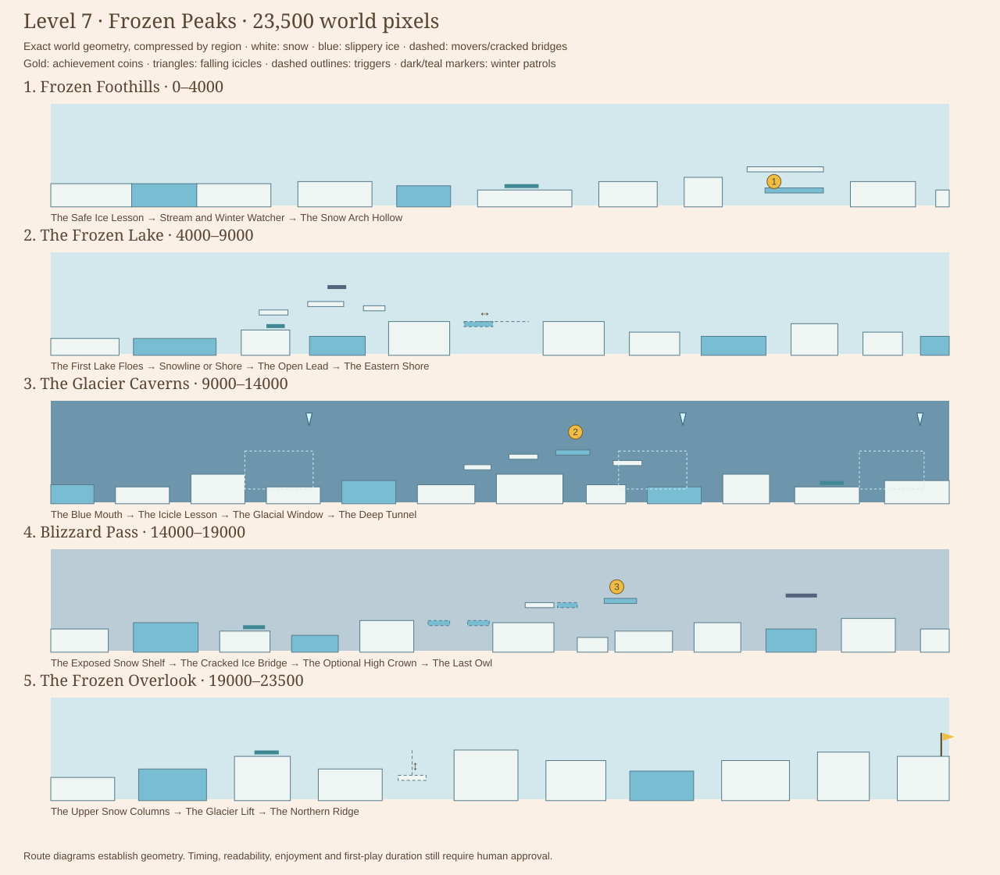

| Area | Exact range | Encounter beats and purpose |
| --- | --- | --- |
| Frozen Foothills | 0–4,000 | **Safe Ice Lesson:** a blue strip is enclosed between level snow catch areas, before the first pit or enemy. **Stream and Winter Watcher:** a short stream, icy landing and a separate snow-bank slime. **Snow Arch Hollow:** cross the upper arch normally, or drop behind it into a lower icy pocket and turn back for gold. |
| The Frozen Lake | 4,000–9,000 | **First Lake Floes:** alternating ice and snow islands develop braking. **Snowline or Shore:** a dry upper ridge with an owl patrol offers a different challenge from the lower slippery floe. **Open Lead:** an icy ferry crosses a real 520px opening. **Eastern Shore:** recover on snow, then cross broader floes toward the glacier. |
| The Glacier Caverns | 9,000–14,000 | **Blue Mouth:** enter enclosed blue walls rather than outdoor mountains. **Icicle Lesson:** observe and bait the first falling hazard from snow. **Glacial Window:** explore an upper luminous chamber for Coin 2; the lower tunnel stays independent. **Deep Tunnel:** separated icy terrain, a snow patrol and a final icicle warning lead outside. |
| Blizzard Pass | 14,000–19,000 | **Exposed Snow Shelf:** ice, normal snow and one visible patrol. **Cracked Ice Bridge:** cross two timed slabs over a genuine chasm. **Optional High Crown:** take an upper cracked-ice route for gold or use the lower snow gully. **Last Owl:** a final airborne patrol and exposed icy takeoff after a recovery bank. |
| The Frozen Overlook | 19,000–23,500 | **Upper Snow Columns:** regain elevation, with one separated frost slime. **Glacier Lift:** reach a genuinely higher snow shelf. **Northern Ridge:** one last ice-to-snow transition, then a safe final climb and flag beneath distant gray mountain cliffs. |

There are 71 authored platforms, including 21 blue ice surfaces, seven creatures,
three falling icicles, four optional areas and exactly three achievement coins.
The 980px continuous opening is deliberately a safe teaching floor with three
surface zones, not empty filler. Elsewhere, changes in elevation, separated
landings, route choices and recovery islands structure the journey.

## Slippery ice physics

`engine/SurfaceMovement.js` is a reusable opt-in layer used by the existing
`Physics.moveHorizontally` function. Platforms declare:

```js
surface: { type: "ice", acceleration: 1000, braking: 900, friction: 600 }
```

Only blue ice uses this profile. Snow and all earlier normal terrain preserve the
existing instantaneous horizontal input. At full run speed, releasing on ice
stops the player in approximately **0.47s over 65px**. Opposite input first slows
and then reverses velocity; it does not flip position or speed instantly.

Velocity and displacement use exact constant-acceleration integration, including
the portion of a frame after the desired speed is reached. This avoids making
coasting distance depend on frame rate. Landing and changing surfaces still use
the existing collision/support system.

Jumping from ice carries the current horizontal velocity into the air, with
responsive 1800px/s² air steering. Releasing in that ice-launched jump preserves
momentum until landing; white snow then restores ordinary stopping. Normal jumps
from earlier levels retain their previous air controls. Wall collisions clear
blocked momentum; world boundaries clamp and stop outward sliding. Reset clears
horizontal velocity and the ice-airborne flag. Flight uses its separate movement
path and clears ice momentum, while disabling flight uses the existing safe
placement/reset process. Pausing freezes velocity and timers rather than consuming
paused wall time.

The visible distinction is intentional: blue glossy ice has traction; matte white
snow does not. Cracked ice bridges show an initial blue crack, then the existing
warning shake/darker cracks and collapse animation. Reduce Motion retains the
warning markings while suppressing shake and snowfall motion.

## Coins and optional places

| Stable ID | Center | Intended exploration route |
| --- | --- | --- |
| `level-7-coin-1` | x3220/y420 | The Frozen Hollow lies beneath the snow arch. From the eastern bank, jump to the arch, walk just off its right lip, then turn left below it into the lower ice pocket. Brake and reverse for gold, then jump back through the arch or return to the eastern snow bank. |
| `level-7-coin-2` | x11920/y200 | From the window court, use the x11300/y355 and x11550/y305 ledges to reach the blue chamber at x11810/y285. The high gold requires the upper route and a small jump; lower main-route jumps cannot accidentally take it. Leave through the eastern ledge or drop into the underpass and reconnect. |
| `level-7-coin-3` | x17150/y230 | From the bridge's eastern bank, climb to the snow launch at x16640/y305. Cross the cracked ice shelf at x16820/y305, move toward its right side before the next jump, then land on the upper icy crown at x17080/y285. Take gold and descend to the lower return bank. |

Coin 2 was raised during validation because its first proposed height allowed
incidental lower-route pickups. That made a zero-coin main run needlessly precise.
The published height keeps the main route independent and the upper reward useful.

| Optional area | Entrance x / feetY | Reward or alternative | Reconnection x / feetY |
| --- | --- | --- | --- |
| The Frozen Hollow | 3600 /420 | Lower icy pocket and Coin 1; a real space beneath an arch | 3680 /420 |
| The Snowline Ridge | 5120 /420 | Stable upper ledges with an owl, avoiding the middle slippery floe | 6040 /380 |
| The Blue Window | 11140 /450 | A connected upper glacial chamber and Coin 2 | 12420 /460 |
| The Windless Crown | 16530 /400 | Optional high cracked shelf, icy crown and Coin 3 | 17400 /440 |

All optional areas have authored clues, support surfaces and safe reconnections.
They are not ordinary platforms hidden only by decorative snow. The Hollow has
100px between its floors, leaving headroom below the arch. The Blue Window has a
large carved wall opening; the high Crown is framed by a natural ice outcrop.

## Platforms, creatures and hazards

| Encounter | Geometry / settings | Reason for placement |
| --- | --- | --- |
| First ice lesson | x360–650/y430, snow on both sides | Teach acceleration and release before dangerous gaps; the 330px snow catch is much wider than the stopping distance. |
| Lake ferry | x6300/y380, width160, horizontal travel280, speed65, endpoint pause0.5s | Cross x6220–6740, a gap a normal jump cannot replace. A broad snow bank is available at either end. The carriage itself is icy, so riders can learn to settle before departure. |
| Main cracked ice bridge | x16100 and16320/y390, width120, 1.5s warning | Both slabs cross the actual x16020–16460 opening; there is no harmless floor below. |
| Optional cracked ridge | x16820/y305, width110, 1.6s warning | Cross the real x16800–16930 cleft to an isolated high coin perch. The lower gully is a separate route, not a duplicate upper stepping stone. |
| Glacier lift | x20740/y420, width140, rises120 to y300, speed50, pause0.5s | Lift riders to the high shelf at x21020/y300. The departure is lower, the shaft is clear and no fixed ledges duplicate the transfer. |

**Frost slimes:** five pale teal slimes reuse the existing patrol, stomp, squash
and reset system. They occupy snow banks after safe landings rather than crowding
slippery edges. Dark outlines keep them distinct from the blue ice.

**Snow owls:** two non-stompable flying patrols reuse the bat's horizontal flight
architecture, with rounded wings and a different face/silhouette. One guards the
optional lake ridge; the other times the later exposed crossing. The original
lake owl placement competed with the mandatory icy takeoff, so it was moved to
the optional ridge during route review. No combat, projectile or new enemy AI
system was added.

**Falling icicles:** use `Stalactite`, including its swept trigger entry, warning,
falling-only damage, impact and reset behavior. Appearance is a variant, not a
second falling-hazard engine.

| Icicle ID | Hanging rectangle x/y/w/h | Trigger x/y/w/h | Warning / fall speed | Safe snow observation |
| --- | --- | --- | --- | --- |
| `l7-first-icicle` | 10420 /110 /26 /48 | 10080 /290 /380 /180 | 0.9s /600 | x10010/y400; enter the trigger near x10060 and wait on that bank |
| `l7-window-icicle` | 12500 /110 /26 /48 | 12160 /290 /380 /180 | 1.0s /600 | The underpass or eastern window ledge, before proceeding to the lower ice |
| `l7-exit-icicle` | 13820 /110 /26 /48 | 13500 /290 /360 /180 | 1.2s /600 | The right side of the tunnel snow bank, beyond the slime patrol |

Icicles have a visible shake/exclamation warning and a floor landing marker.
The first lesson can catch a blind runner, but baiting it from snow is safe at all
three tested rates. The blizzard is visual atmosphere: **no wind-force zones**
were added. Sparse snowflakes and distant fog do not cover platforms or warnings.

## Original music and progression

**Footprints Beneath the Northern Lights** is an original 24-bar, 4/4 track at
92BPM, approximately 62.61s per loop. Bell melody, airy flute answers, soft keys,
pad and a light shaker create an open winter mood. It has an answering middle
phrase and varied return, rather than copying the Crystal Cave arrangement.
The existing audio registry, worker/preparation, fades, settings, mute, pause,
completion cue and map-music behavior remain in use. The listening room now has
eight original arrangements, including Frozen Peaks.

Completing Level 6 unlocks 7. Selecting Frozen Peaks on the existing map shows
its name and three coin indicators. Finishing saves pending coins and completion,
then shows the existing popup. Completing 7 unlocks 8 in progression data, but
Level 8 stays unavailable and Next says Coming soon. Nothing automatically
advances to another level. Replay resets enemies, platforms, icicles and momentum.

Coins bank only at the finish, union by stable IDs, and remain account-specific.
Death or abandonment discards new pickups; previously earned coins remain faded
and credited. Developer-assisted runs cannot save. Shop currency is unaffected.

## Rendered review

These are **native canvas previews using the actual renderer code**, not browser
screenshots or human playtesting. They use the fallback avatar, with selected
states staged for visual inspection. Your equipped-character appearance still
needs checking in the browser.

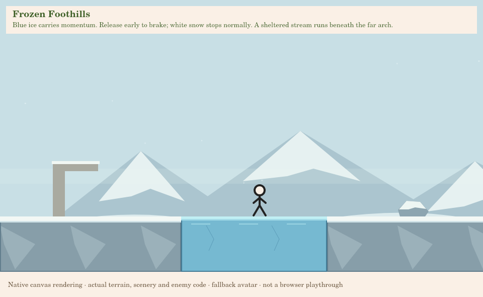
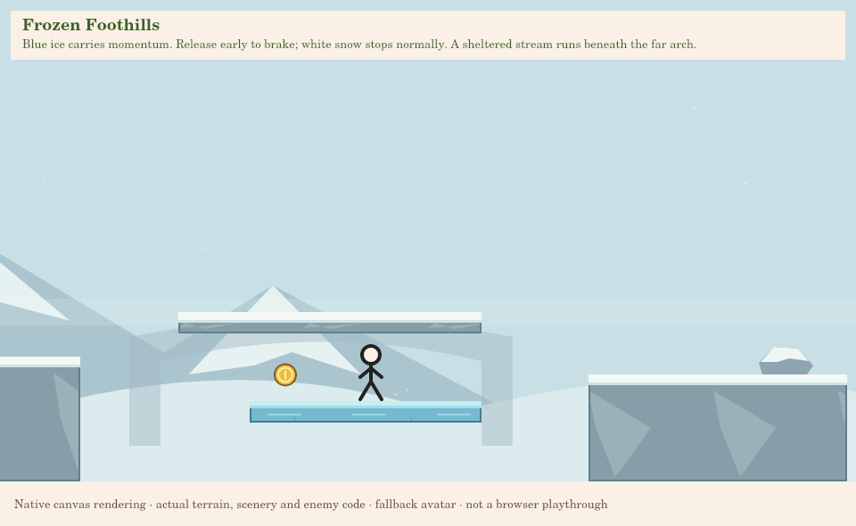
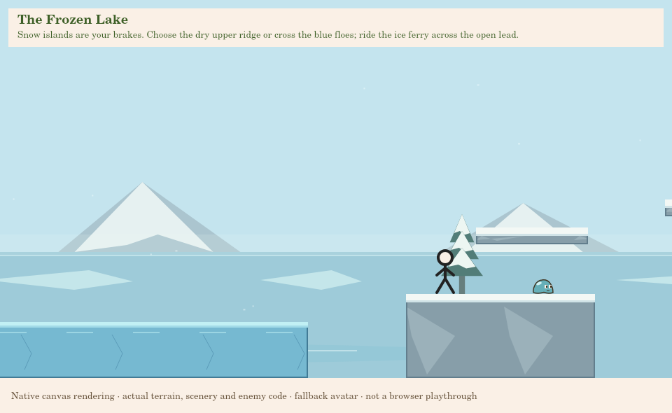
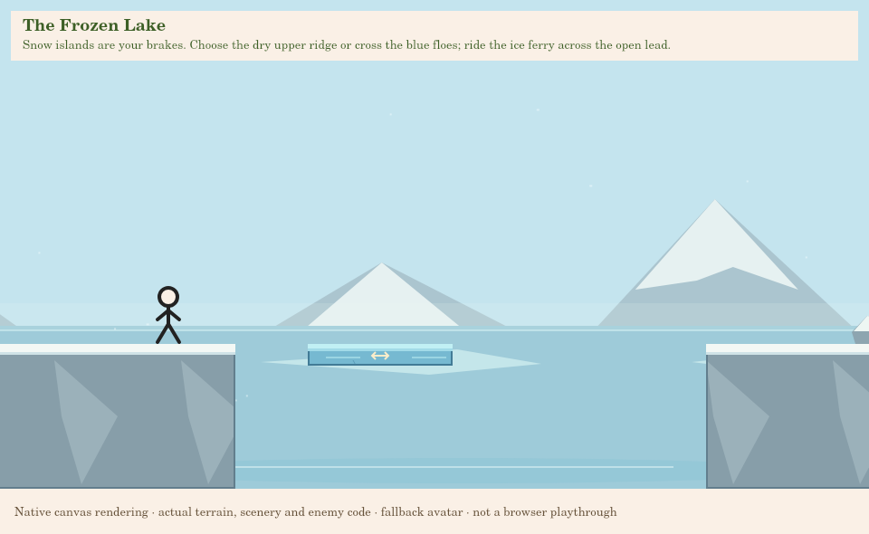
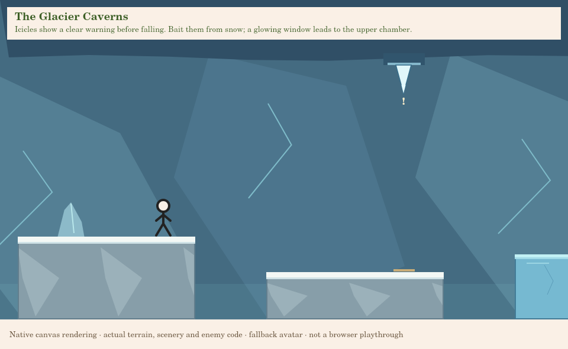
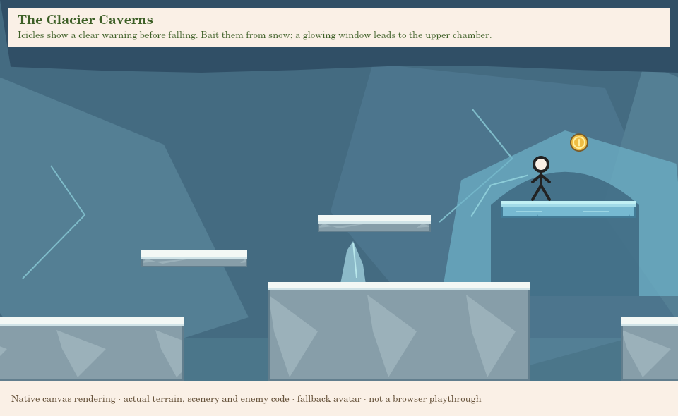
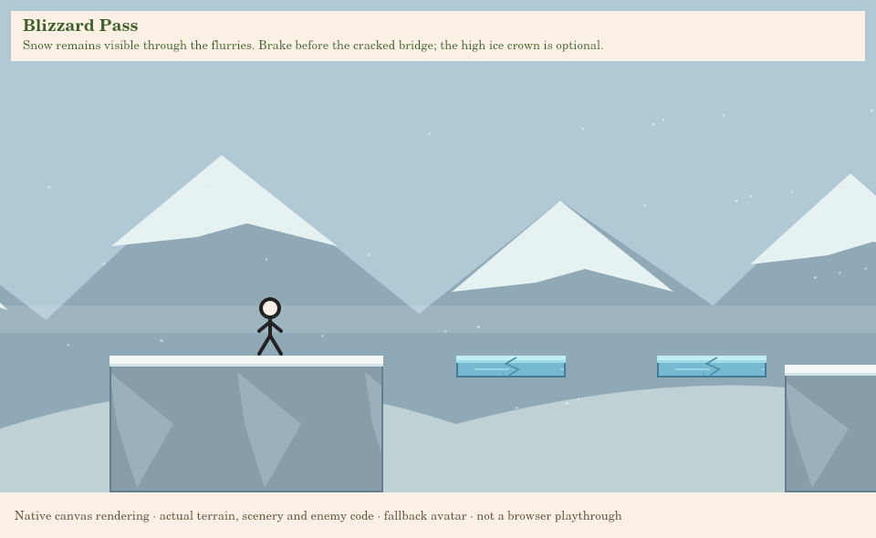
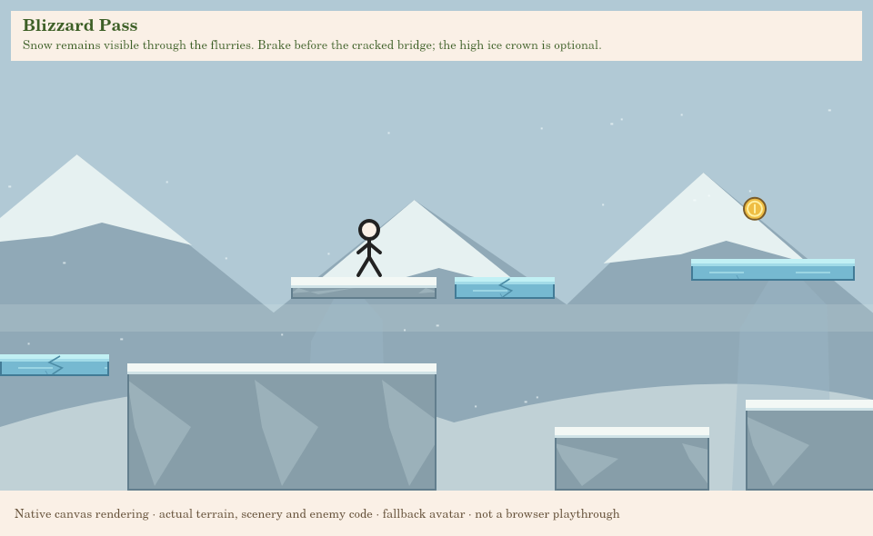
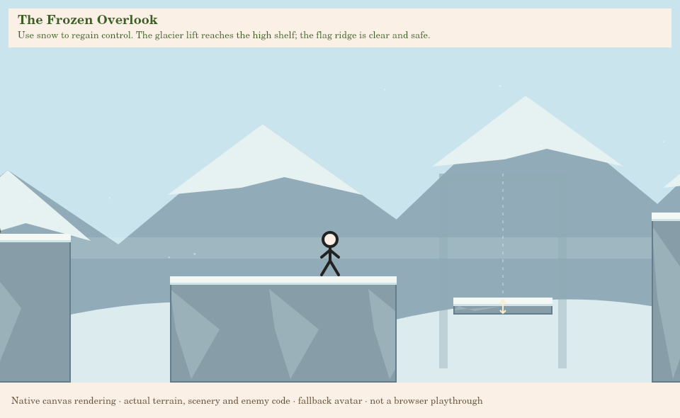
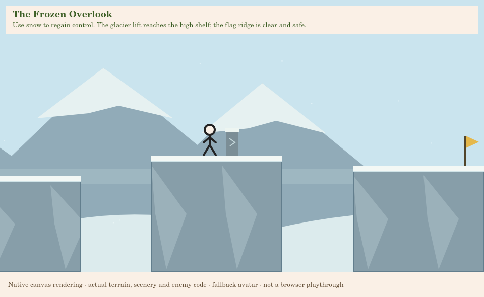

The backgrounds change composition, not just palette: a low snowy valley, a wide
flat lake, enclosed glacial ceiling/wall facets, an exposed storm pass and higher
mountain silhouettes. Foreground pines are individually placed with canopy
spacing; boulders and support outcrops do not obscure patrols. Geometry remains
simple and uses the shared collision rectangles.

## Automated evidence and limits

Run from the repository root:

```sh
npm test
npm run validate:levels
```

**Results: `npm test` passed all 243 tests; `npm run validate:levels` passed for
all seven levels**, including the six full Level 7 traces and twelve local
exploration witnesses at the required frame rates. Coverage includes:

- All earlier tests remain active, with expanded registry/count expectations for 7.
- Six full spawn-to-flag traces: zero coins and all three coins at 30/60/120FPS.
  Live enemies, icicles, traction, movers, collapse timers and camera checks remain
  enabled. No flight, invincibility, teleportation or deleted enemies proves them.
- Twelve local entrance → discovery/reward → reconnection traces. These explicitly
  begin at declared optional entrances, separate from complete course proofs.
- Exact acceleration/coast/reversal measurements, jump/landing, ordinary-ground
  recovery, wall collision, reset, and flight separation tests.
- Mover boarding from several arrival phases, reversal carry, jump-off, late bridge
  escape, falling-icicle trigger/death/bait/reset and creature stomp/patrol tests.
- Actual game-entry UI tests with mocked browser/auth boundaries cover paused ice
  velocity, paused icicle warnings, music selection, completion/replay/Next/map,
  account changes and developer no-save behavior.
- A pre-change HEAD baseline verifies all six earlier authored level definitions
  and seven earlier musical arrangements remain identical.

Structural gap warnings at the snow arch, lake ferry, cracked bridge and lift are
expected: the graph and full routes test their authored traversal surfaces rather
than treating those openings as ordinary ground jumps.

**Not verified by automation:** human enjoyment, perceived difficulty, browser
performance, equipped-avatar appearance, musical preference and first-play pacing.
Chromium cannot launch here: `socket() failed: Operation not permitted`.
The optimized traces take about **98–104 seconds**, not a measured human first run.
The requested **5–8 minute first-successful-playthrough target remains unverified**
until you play and time the adventure. Passing routes establish possibility, not
polish or final approval.

## Manual testing in VS Code

You authorized pushing this work after testing. Update your checkout with:

```sh
git switch game-prototype
git pull --ff-only origin game-prototype
```

1. Start your usual local server and keep the hostname/port used for your existing
   account saves. Open `/game/`, sign in and select Frozen Peaks after completing
   Level 6. Verify its three map coin indicators.
2. Keep developer assistance off for a legitimate run. On the first ice strip,
   release movement and observe the coast. Reverse direction, stop on snow and
   try a jump with momentum. The surrounding snow should feel immediately normal.
3. Cross the stream and meet the first frost slime on its separate snow bank.
   Stomp it on one attempt and test side collision on another; retry should
   restore it and reset sliding velocity.
4. Explore the Frozen Hollow: reach the eastern bank, jump back to the arch,
   step off its right edge and turn left below it. Take Coin 1, brake, then leave
   through the upper arch or the eastern bank. Try the main route without it too.
5. At the lake, compare the lower blue floe with the upper snow ridge and owl.
   Ride the ferry, release input to settle on its surface and wait through a
   reversal. Jump to the snow bank normally.
6. In the glacier, observe the first icicle from x10010/y400. Edge into its trigger,
   wait safely on snow while it falls and then cross. Deliberately rush it on
   another attempt to verify damage and reset. Pause during warning, wait a few
   real seconds, resume and check the warning did not expire while paused.
7. Enter the Blue Window chamber for Coin 2. Brake on the upper ice, take the high
   gold and reconnect with the tunnel. A normal lower-route jump should not
   accidentally collect it. Compare the optional chamber with the lower path.
8. In Blizzard Pass, use snow as recovery before each slippery landing. Cross the
   cracked bridge promptly; on another attempt wait until it collapses. For the
   optional Crown, move toward the right side of the short cracked shelf before
   the next jump. Take Coin 3, then descend safely.
9. Climb to the Overlook, ride the lift to its genuinely higher shelf and finish
   at the clear flag. Inspect the popup's coin indicators, Replay and World Map.
   Next remains Coming soon for Level 8; no automatic advance should occur.
10. Test partial collection followed by death and abandonment. New coins must not
    persist; earned coins should stay faded after replay/refresh. A different
    account must not inherit them. Inspect your existing shop equipment in play.
11. Test volume/mute and pause/resume. Return to the map and check that its music
    resumes without overlap. Preview the winter track separately at
    `/game/dev/music-preview.html` if desired.
12. Enable Reduce Motion and inspect both icicle and bridge warnings. They must
    remain understandable without shake. Note confusing jumps, excessive sliding,
    repetitive areas, missed warnings and first-successful-run duration for review.

## Developer inspection destinations

Use the existing explicit opt-in local server:

```sh
python game/scripts/serve-development.py --dev-tools
```

Pause → Settings → Developer Mode → Enable Developer Tools → Admin Tools. Select
Level 7 there if locked. Fly, invincibility, speed, hitboxes, restart and map use
the existing tools. **Assisted runs cannot save achievements.** Turning tools off
does not clean the current attempt; restart without assistance for a legitimate run.

| Destination | Requested x / feetY |
| --- | --- |
| Level Start | 96 /430 |
| Coin 1 | 3220 /450 |
| Coin 2 | 11920 /230; safe placement selects a nearby actual surface |
| Coin 3 | 17150 /260; safe placement selects a nearby actual surface |
| Frozen Hollow entrance | 3625 /420 |
| Snowline Ridge entrance | 5145 /420 |
| Blue Window entrance | 11165 /450 |
| Windless Crown entrance | 16555 /400 |
| Ice lesson — safe snow approach | 270 /430 |
| Frozen Lake — ferry departure | 6120 /380 |
| Glacier Caverns — snow observation bank | 9430 /460 |
| Icicle lesson — outside trigger | 10010 /400 |
| Blizzard Pass — cracked bridge approach | 15900 /390 |
| Frozen Overlook — lift departure | 20560 /390 |
| Final Challenge: Blizzard Pass | 14032 /460; safe placement adjusts to the real bank |
| Finish Flag | 23410 /330 |

Safe teleport positions use static support and reset momentum. Hitboxes show
falling icicle bounds and dashed trigger rectangles through the existing debug
renderer. Surface locations and blue material distinguish traction-bearing ice.
Flight remains independent of the ice controller and safely resets when disabled.

## New and modified files

| Responsibility | Files |
| --- | --- |
| New surface physics | `engine/SurfaceMovement.js` |
| New authored content | `levels/Level7.js`, `levels/Level7Scenery.js` |
| New rendering | `rendering/FrozenRenderer.js`, `rendering/FrozenTerrain.js` |
| Existing movement integration | `engine/Physics.js`, `engine/stepLevel.js`, `entities/Player.js`, `levels/design/validateLevel.js`, `dev/DebugRenderer.js` |
| Existing art and entry point | `rendering/PlatformRenderer.js`, `rendering/EnemyRenderer.js`, `rendering/CaveMechanicsRenderer.js`, `game.js` |
| Registration and music | `levels/levels.js`, `index.html`, `audio/MusicScores.js`, `dev/music-preview.html` |
| New automated coverage | `tests/ice.test.mjs`, `tests/level7.test.mjs`, `tests/fixtures/pre-frozen-baseline.json`, `level7-routes.json`, `level7-main-routes.json` |
| Extended existing coverage | `tests/fixtures/exploration-routes.json`, `tests/helpers/pauseGameHarness.cjs`; audio, biome-music, coin-reset, design, developer, exploration, level3/4/5/6, map, platform-purpose and stomp test expectations |
| Review material | This guide, `docs/README.md`, `level7-layout.svg`, ten `level7-*.png` native previews |

Generic hazard regression tests now cover falling icicles when a level has no
static thorns, rather than assuming every biome contains thorn rectangles. All
previous thorn/death checks remain active for the earlier levels. No collision
rules or previous route fixtures were weakened to pass this level.
