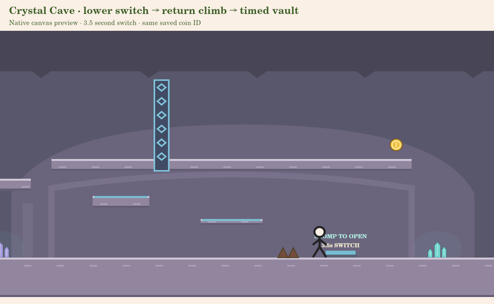

# Crystal Cave: timed vault and falling-spike revision

This revision stays on `game-prototype`. It changes only the cave encounters and
shared configurable switch behavior; Levels 1–3, account saves, movement physics,
coin IDs and the first two coin positions, ferry/cracked-slab definitions and the finish flag are preserved.
Gameplay feel still needs your approval.

## The vault now asks for a return climb

The old plate on the upper approach shelf opened the door permanently, immediately
beside the route to the coin. It has moved to the lower floor where you marked it:
**x13030–13094, floor y460**, to the right of the door and beside the old thorn patch.

1. Jump and land on the blue button. Walking over it or jumping upward through it
   does not activate it.
2. The matching door at x12700 opens for **3.5 seconds**, with a visible countdown.
3. Turn left onto the low blue-edged step at x12790/y382, then the upper step at
   x12580/y335. Turn right, jump into the vault and pass through the door for Coin 3.
4. If it closes, drop back to the lower floor and stomp the switch again. Re-stomping
   refreshes its full timer; standing on it does not keep the door open.

Coin 3 keeps its saved ID and moves 120px deeper into the vault, to x13170/y230,
so it cannot be collected by jumping through the floor from below.

The low step is intentionally too low to jump straight onto the vault from its right
side. The upper step is left of the wall. Both need to be used to solve the timed
return climb. The older cracked slab still crosses its actual pit and reaches an
approach shelf; it no longer opens the gate. The main ground route remains optional
and does not require collecting the vault coin.

The door gives clearance grace only while a player physically overlaps its doorway,
so expiration cannot crush or teleport them. It closes as soon as the doorway clears.
All timers, activation/contact state and gates reset with death, R, load and replay.
Timers advance only with gameplay updates, so pausing freezes them.

## More deliberate falling-spike encounters

There are now **11** falling spikes instead of six. They remain fixed to authored
lanes, warn with shaking/color/`!`, and show a small landing marker before falling.
They do not track or home toward the player. The existing swept collision and
platform shielding are reused.

| Area | Spike x positions | Purpose |
| --- | --- | --- |
| Crystal Passages | 3020, 3500 | A longer introductory warning, then a gallery-route drop. |
| Stalactite Cavern | 6500, 6910, 7670, 7930, 9020 | A shelf encounter and two separated approach lanes requiring a change in pace. |
| Ancient Chamber | 10080, 11540 | Separate encounters before/after the ferry; none inside the timed vault race. |
| Cave Exit | 13980, 14400 | A final warning sequence before the last gap; the flag bank stays safe. |

Drop speed is 720px/s. Warning times are 0.6–0.9 seconds, with authored trigger leads
matched to the 280px/s run speed and the drop height. Unlike the old early-trigger,
long-delay combination, the main challenge lanes can hit a player who blindly holds
right. Stop short, retreat, or bait the warning and cross after impact. Safe spaces
between lanes allow recovery rather than overlapping unavoidable falls.

## Verification and manual checks

Run `npm test` and `npm run validate:levels` from the repository root.

Executed for this revision: **179 tests pass**, and all four implemented levels
pass layout/full-route/exploration validation at 30/60/120 FPS. The revised cave's
optimized all-coin traces take about 60–61 seconds; coin-free traces take about
57–58 seconds. These timings establish reachable routes, not human play duration.

Targeted tests cover expiry, holding/re-stomping, actual downward activation,
doorway clearance, reset, closed-door/no-shortcut behavior and real return-climb
inputs at 30/60/120 FPS. Separate tests prove that selected approach lanes hit a
blind runner while a stopped player can safely bait the same spike. These isolated
timing tests are distinct from full spawn-to-flag routes with every hazard enabled.

Recorded full-course and local-secret witnesses are updated for the new encounters.
They are feasibility evidence using the real physics, not human playtesting. The
scope baseline now protects the cave entrance and Levels 1–3 while allowing this
requested revision of the cave's later challenges. Coin IDs, existing interactive
platform definitions and all finish definitions remain protected.

In your browser:

- Check that the lower button sits where you expected and is readable near your avatar.
- Walk across it: the door should stay closed. Stomp it, follow the two blue steps,
  and judge whether 3.5 seconds gives a fair but meaningful time limit.
- Deliberately wait, then retry. Pause mid-countdown and verify that time freezes.
- Stand near a drop lane, watch its warning and bait it safely. Try rushing a few
  lanes to check the new danger. Reduce Motion must keep the warning readable.
- Finish once without coins and once with all three. Verify death/replay resets
  everything and new coin credit still requires the flag.

The native canvas preview uses the actual renderer and fallback character; it is
not a browser screenshot or a real-account equipment test. Final difficulty,
responsiveness, sound and appearance require your local approval. Developer-assisted
runs remain test-only and cannot save progress.
